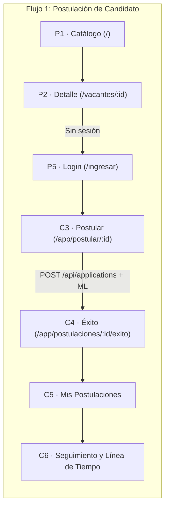

# Especificación completa del Frontend (Arquitectura, Diseño y 53 Pantallas por Rol)

Guía de ingeniería y diseño de interfaz para la construcción del Frontend definitivo (v2) de la **Plataforma Web de Reclutamiento y Selección de Personal con Aprendizaje Automático**. Redactada en total coherencia con [`backend/BACKEND_ESPECIFICACION.md`](../backend/BACKEND_ESPECIFICACION.md), el esquema de base de datos **v4** ([`backend/prisma/schema.prisma`](../backend/prisma/schema.prisma)), el microservicio de Machine Learning ([`ml-service/app/api/routes.py`](../ml-service/app/api/routes.py)) y la capa de servicios HTTP ya conectada en [`frontend/src/services/`](./src/services/).

> **Regla de oro de seguridad:** La interfaz gráfica **solo oculta o adapta** elementos por experiencia de usuario (UX); el control de acceso real, el rol (`CANDIDATO`, `RRHH`, `ADMIN`, `SUPER_ADMIN`), la pertenencia a una empresa (`empresaId`) y el estado de la cuenta siempre los decide y valida el Backend en cada petición mediante el token JWT y la consulta en vivo a PostgreSQL.

> **Regla de oro de identidad y datos:** La plataforma **no tiene nombre comercial fijo** en el código: la interfaz muestra únicamente el **isotipo geométrico / logo institucional limpio**. Queda prohibido quemar en el código textos como `"Nexo Tecnología"` o datos de demostración cableados (como el nombre, correo o avatar de `"Valeria Mendoza"` o `"Carlos Arismendi"`). Todo dato en pantalla proviene de la sesión real (`AuthContext` / `GET /api/auth/me`) o de los servicios en `src/services/`.

---

## 0. Cómo leer este documento y convenciones técnicas

### 0.1 Conceptos base

- **Pantalla (`P*`, `C*`, `E*`, `A*`, `S*`):** Es una vista independiente con **su propia ruta URL** en el navegador. Los modales, cajones laterales (_drawers_) y pestañas (_tabs_) viven dentro de la pantalla que los aloja y se especifican dentro de su sección correspondiente.
- **Rutas de navegación vs. Rutas de API:**
  - Las **rutas del navegador (Frontend)** están en español claro y semántico (`/vacantes/:id`, `/app/explorar`, `/empresa/postulantes/:id`, `/plataforma/solicitudes`).
  - Las **rutas de la API (Backend)** están en inglés REST estándar (`/api/vacancies`, `/api/applications`, `/api/company`, `/api/admin/companies`, `/api/ml/metrics`) y se consumen **exclusivamente** a través de los archivos de `frontend/src/services/*.service.ts` (nunca haciendo `fetch` suelto dentro de un componente `.tsx`).
- **Etiqueta `(Fase 2)`:** Indica pantallas o funciones proyectadas para la segunda etapa evolutiva. Su ruta y estructura quedan reservadas en la arquitectura sin bloquear la entrega de la primera versión productiva.

### 0.2 Stack tecnológico obligatorio (sin romper la base actual)

| Capa              | Tecnología                                                         | Uso en el proyecto                                                                                                                        |
| :---------------- | :----------------------------------------------------------------- | :---------------------------------------------------------------------------------------------------------------------------------------- |
| **Core UI**       | **React 19 + TypeScript**                                          | Componentes funcionales estrictamente tipados (`src/types/index.ts`).                                                                     |
| **Bundler**       | **Vite 8**                                                         | Compilación ultrarrápida, alias `@/*` apuntando a `./src/*` y variables `import.meta.env.VITE_*`.                                         |
| **Estilos**       | **Tailwind CSS v4** (`@tailwindcss/vite`)                          | Tokens de diseño, variables CSS nativas para modo claro/oscuro, superficies _Liquid Glass_ y micro-interacciones.                         |
| **Iconografía**   | **Lucide React** (`lucide-react`)                                  | Trazos uniformes (`strokeWidth={1.75}` en vistas densas, `2` en acciones primarias).                                                      |
| **Enrutamiento**  | **Router real basado en URL (`History API` / `react-router-dom`)** | Indispensable para leer parámetros dinámicos (`:id`) y query strings de correo (`?token=...` en verificación, recuperación e invitación). |
| **Capa de Datos** | **`src/services/*.service.ts`** sobre **`src/services/api.ts`**    | `USE_MOCK = false`. Comunicación 100% real con Express (`:4000/api`) y FastAPI (`:8000` vía backend).                                     |

### 0.3 Mapa de conexión con `frontend/src/services/` (Ya construidos y listos)

Ningún cambio visual debe alterar las firmas de estos 11 archivos en `src/services/`:

| Archivo en `src/services/`                                            | Endpoints del Backend que consume                                                                                                                                                                                             | Pantallas que lo utilizan                                               |
| :-------------------------------------------------------------------- | :---------------------------------------------------------------------------------------------------------------------------------------------------------------------------------------------------------------------------- | :---------------------------------------------------------------------- |
| [`api.ts`](./src/services/api.ts)                                     | Cliente base `GET`, `POST`, `PUT`, `PATCH`, `DELETE`, `UPLOAD` con JWT automático y parseo de errores `{ error, message }`.                                                                                                   | Todas (a través de los servicios).                                      |
| [`auth.service.ts`](./src/services/auth.service.ts)                   | `/auth/login`, `/auth/register`, `/auth/google`, `/auth/google/complete-profile`, `/auth/me`, `/auth/verify-email`, `/auth/resend-verification`, `/auth/recover-password`, `/auth/reset-password`, `/auth/accept-invitation`. | `P5`, `P7`, `P8`, `P9`, `P10`, `P11`, `P12`, `P13`, `C11`, `E14`, `S9`. |
| [`vacancies.service.ts`](./src/services/vacancies.service.ts)         | `GET /vacancies`, `GET /vacancies/company`, `GET /vacancies/:id`, `POST /vacancies`, `PUT /vacancies/:id`, `PATCH /vacancies/:id/status`, `DELETE /vacancies/:id`.                                                            | `P1`, `P2`, `P4`, `C1`, `C2`, `E1`, `E2`, `E3`, `E4`.                   |
| [`candidates.service.ts`](./src/services/candidates.service.ts)       | `GET /candidates/me`, `PUT /candidates/me`, `POST /candidates/me/photo`, `POST /candidates/me/cv`, `POST /candidates/me/documents`, `DELETE /candidates/me/documents/:id`, `GET /candidates/documents/:id`.                   | `C1`, `C3`, `C10`, `E6`.                                                |
| [`applications.service.ts`](./src/services/applications.service.ts)   | `GET /applications`, `GET /applications/me`, `GET /applications/:id`, `POST /applications`, `PATCH /applications/:id/status`.                                                                                                 | `C3`, `C4`, `C5`, `C6`, `E1`, `E4`, `E5`, `E6`.                         |
| [`chat.service.ts`](./src/services/chat.service.ts)                   | `GET /chat/conversations`, `GET /chat/conversations/:id/messages`, `POST /chat/conversations/:id/messages`, `PATCH /chat/conversations/:id/read`.                                                                             | `C6`, `C7`, `E1`, `E6`, `E7`.                                           |
| [`notifications.service.ts`](./src/services/notifications.service.ts) | `GET /notifications`, `POST /notifications/send`, `GET /notifications/templates`, `PUT /notifications/templates/:evento/:canal`, `DELETE /notifications/templates/:evento/:canal`.                                            | `C8`, `E6`, `E8`, `E13`, `S8`.                                          |
| [`company.service.ts`](./src/services/company.service.ts)             | `GET /company`, `PUT /company`, `GET /company/members`, `POST /company/invitations`, `PATCH /company/members/:id`.                                                                                                            | `E1`, `E12`, `A1`, `A2`, `A3`.                                          |
| [`admin.service.ts`](./src/services/admin.service.ts)                 | `GET /admin/companies`, `PATCH /admin/companies/:id/approve`, `reject`, `deactivate`, `activate`, `GET /admin/users`.                                                                                                         | `S1`, `S2`, `S3`, `S4`, `S5`.                                           |
| [`ml.service.ts`](./src/services/ml.service.ts)                       | `GET /ml/health`, `POST /ml/predict`, `POST /ml/rank`, `POST /ml/extract`, `GET /ml/metrics`, `POST /ml/train`, `POST /ml/upload-dataset`.                                                                                    | `C1`, `E4`, `E6`, `S1`, `S7`.                                           |
| [`reports.service.ts`](./src/services/reports.service.ts)             | `GET /reports/comparison`.                                                                                                                                                                                                    | `E11`, `S1`.                                                            |

---

## 1. Resumen de pantallas por rol y transición desde el Frontend v1

### 1.1 Conteo oficial de las 53 pantallas

| Rol                              |           Pantallas propias           | Alcance funcional                                                                                                                                                                                                                                                                                                                                                                                              |
| :------------------------------- | :-----------------------------------: | :------------------------------------------------------------------------------------------------------------------------------------------------------------------------------------------------------------------------------------------------------------------------------------------------------------------------------------------------------------------------------------------------------------- |
| **Visitante (sin sesión)**       |         **16** (`P1` – `P16`)         | Catálogo público de vacantes, directorio de empresas, login único, registro bifurcado (candidato/empresa), verificación de correo, recuperación/restablecimiento de clave, aceptación de invitación, completar perfil Google, bloqueo de empresa no activa, términos y pantallas de sistema.                                                                                                                   |
| **Candidato (`CANDIDATO`)**      | **11** (`C1` – `C11`, _C9 en Fase 2_) | Exploración inteligente ordenada por afinidad ML, detalle de vacante, postulación con datos precargados del perfil, confirmación, seguimiento de postulaciones, línea de tiempo, chat en vivo con empresas, centro de notificaciones, ofertas (Fase 2), perfil en 4 pestañas y ajustes de cuenta.                                                                                                              |
| **RRHH de Empresa (`RRHH`)**     | **14** (`E1` – `E14`, _E9 en Fase 2_) | Dashboard operativo con alertas de vigencia/inactividad, gestión de vacantes, creador/editor de vacantes, ranking por vacante, bandeja global de postulantes, expediente central con explicabilidad ML + decisión con previsualización, chat multi-reclutador, editor de plantillas, buscador de talento (Fase 2), auditoría de empresa, reportes comparativos, perfil de empresa, notificaciones y mi cuenta. |
| **ADMIN de Empresa (`ADMIN`)**   |  **17** (`E1` – `E14` + `A1` – `A3`)  | Todas las 14 pantallas de RRHH (con permisos de edición sobre `Mi empresa` y línea base de `Reportes`, más tarjeta de RRHH en `Dashboard`) **+ 3 pantallas exclusivas de gestión de equipo**: lista de miembros/invitaciones (`A1`), invitar miembro (`A2`) y expediente/auditoría de miembro (`A3`).                                                                                                          |
| **SUPER_ADMIN (`SUPER_ADMIN`)**  |          **9** (`S1` – `S9`)          | Gobernanza global de la plataforma: dashboard maestro, cola de solicitudes de empresas pendientes, directorio y vigencia de empresas, expediente de empresa, directorio global de usuarios, auditoría global, centro de control del modelo de Machine Learning (métricas, reentrenamiento, datasets CSV), plantillas base de la plataforma y mi cuenta.                                                        |
| **Total de pantallas distintas** |                **53**                 | `16 + 11 + 14 + 3 + 9 = 53` vistas con ruta propia.                                                                                                                                                                                                                                                                                                                                                            |

### 1.2 Qué pasa con las 7 páginas actuales del Frontend v1 (Mapa de migración)

1. **`LoginPage.tsx` ➔ Pasa a `P5 (/ingresar)`:**
   - **Qué cambia:** Se eliminan por completo las 3 pestañas manuales de selección de rol (`Aspirante`, `Recursos Humanos`, `Administración`) y se borran los correos/contraseñas precargados en el estado inicial (`valeria.mendoza@...`). Queda un **formulario único** que detecta el rol desde la respuesta de `authService.login()`.
   - **Qué se separa:** El modal interno de "Recuperar contraseña" se extrae como pantalla propia en **`P10 (/recuperar)`**, y el modal de "Crear cuenta" se transforma en el selector **`P6 (/registro)`** + **`P7 (/registro/candidato)`** + **`P8 (/registro/empresa)`**.
2. **`VacanciesCatalogPage.tsx` ➔ Se divide en `P1 (/)` y `C1 (/app/explorar)`:**
   - En `P1` sirve al visitante sin sesión (ordenado por fecha de publicación) con filtros completos, nombre de la empresa y paginación.
   - En `C1` vive dentro del layout del candidato autenticado y ordena las vacantes según el **puntaje de afinidad calculado por el modelo de ML** frente a su perfil, marcando aquellas a las que ya se postuló.
3. **`PublicApplicationPage.tsx` ➔ Pasa a `C3 (/app/postular/:vacanteId)`:**
   - **Ya no es una pantalla pública sin sesión.** Si un visitante pulsa "Postularme" en `P1` o `P2`, se redirige a `P5 (/ingresar?redirect=/app/postular/:vacanteId)`.
   - En `C3`, los datos personales (nombres, cédula, correo, teléfono) vienen **precargados en solo lectura** desde el perfil del candidato (`candidatesService.getProfile()`), permitiendo elegir el CV vigente del perfil o subir uno nuevo.
4. **`SuccessRegistrationPage.tsx` ➔ Pasa a `C4 (/app/postulaciones/:id/exito)`:**
   - **Se elimina el formulario de "crea tu contraseña"** (porque el candidato ya está autenticado antes de postular). Muestra el código de postulación, resumen de lo enviado y los pasos siguientes (correo, WhatsApp y chat).
5. **`CandidateDashboardPage.tsx` ➔ Se desglosa en `C5`, `C8` y `C10` (y se crean `C6`, `C7`, `C9`, `C11`):**
   - La lista de postulaciones pasa a `C5 (/app/postulaciones)`.
   - Las notificaciones pasan a `C8 (/app/notificaciones)`.
   - El editor de perfil se organiza en las 4 pestañas de `C10 (/app/perfil)`.
   - Se agregan las vistas faltantes: detalle de postulación (`C6`), chat con empresas (`C7`), ofertas (`C9`) y ajustes (`C11`).
6. **`HRDashboardPage.tsx` ➔ Se separa en `E2`, `E3`, `E4`, `E5` y `E6`:**
   - Hoy mezcla vacantes y postulantes en una sola vista y abre un modal para crear vacantes.
   - Ahora cada responsabilidad tiene su pantalla dedicada: métricas ejecutivas en `E1`, catálogo de vacantes de la empresa en `E2`, formulario completo de creación/edición en `E3`, ranking de una vacante en `E4`, bandeja global de postulantes en `E5` y expediente profundo del candidato en `E6`.
7. **`AdminDashboardPage.tsx` ➔ Se reparte según la arquitectura multiempresa:**
   - La gestión y entrenamiento del modelo de Machine Learning pasa a **`S7 (/plataforma/ml)`** (exclusivo de `SUPER_ADMIN`).
   - El reporte comparativo antes/después pasa a **`E11 (/empresa/reportes)`**.
   - La gestión de usuarios se divide entre **`A1 (/empresa/equipo)`** (donde el `ADMIN` de una empresa gestiona a sus analistas de `RRHH`) y **`S5 (/plataforma/usuarios)`** (donde el `SUPER_ADMIN` ve todos los usuarios de la plataforma).

---

## 2. Sistema de Diseño Visual ("Editorial Liquid Glass & Tactile Minimalism")

### 2.1 Filosofía estética: Cero aspecto de "plantilla generada por IA"

Para lograr una interfaz que se sienta **cara, sobria, humana y de ingeniería de precisión** (inspirada en Linear, Stripe Dashboard, Raycast y Apple macOS Sequoia), se combinan cuatro corrientes de diseño con reglas estrictas:

1. **Flat Design Editorial en zonas de lectura densa:**
   - Tablas de datos, expedientes de candidatos y formularios largos usan superficies planas de alto contraste, tipografía nítida, números tabulares (`font-variant-numeric: tabular-nums`) y divisores ultrafinos (`1px solid`), sin sombras pesadas ni degradados arcoíris.
2. **Liquid Glass / Glassmorphism óptico en capas de navegación y superposición:**
   - Barras superiores fijas (_sticky headers_), paneles flotantes de filtros, menús contextuales y modales de decisión usan desenfoque multicapa (`backdrop-blur-xl backdrop-saturate-150`) con fondo translúcido y un **borde especular superior de `1px`** (`border-white/20` en modo oscuro, `border-slate-900/[0.07]` en modo claro) que simula el grosor real del cristal.
3. **Tactile Skeuomorphism / Micro-Neumorfismo en controles físicos:**
   - Botones de acción principal, selectores segmentados (_segmented controls_), interruptores (_toggles_ de visibilidad de perfil o estado de vacante) e insignias de estado tienen una sutil luz interna superior (`inset 0 1px 0 rgba(255,255,255,0.22)`) y una sombra de contacto corta (`0 1px 2px rgba(0,0,0,0.12)`), dando la sensación táctil de pulsar una tecla mecánica bien calibrada.
4. **Prohibiciones visuales (Anti-IA):**
   - Prohibido usar fondos con degradados morado-neón/cian, ilustraciones genéricas, textos llenos de emojis, bordes gruesos de colores chillones o sombras difusas gigantes (`shadow-2xl` indiscriminado).

### 2.2 Paleta de colores dual (Modo Claro y Modo Oscuro persistente)

| Token Semántico     | Modo Claro (_Warm Alabaster & Ink_) | Modo Oscuro (_Obsidian & Liquid Graphite_) | Uso específico                                                  |
| :------------------ | :---------------------------------- | :----------------------------------------- | :-------------------------------------------------------------- |
| `--bg-canvas`       | `#F6F6F3` (Piedra cálida / Papel)   | `#090B10` (Obsidiana profunda)             | Fondo general de la aplicación.                                 |
| `--bg-surface`      | `#FFFFFF` (Blanco puro)             | `#11141D` (Grafito elevado)                | Tarjetas, tablas, contenedores de formularios.                  |
| `--bg-glass`        | `rgba(255, 255, 255, 0.78)`         | `rgba(17, 20, 29, 0.74)`                   | Barras superiores, modales y paneles _Liquid Glass_.            |
| `--bg-subtle`       | `#EFECE6` / `#F1F5F9`               | `#181C28`                                  | Fondos de chips, filas en _hover_, bloques de código/variables. |
| `--text-primary`    | `#0B0F17` (Tinta carbón)            | `#F3F5F8` (Blanco titanio)                 | Títulos, nombres de candidatos, cifras clave.                   |
| `--text-secondary`  | `#475569` (Pizarra media)           | `#94A3B8` (Acero suave)                    | Descripciones, subtítulos, metadatos de tabla.                  |
| `--text-muted`      | `#64748B`                           | `#64748B`                                  | Fechas secundarias, placeholders, etiquetas deshabilitadas.     |
| `--border-hairline` | `rgba(15, 23, 42, 0.08)`            | `rgba(255, 255, 255, 0.08)`                | Líneas divisoras de `1px` en tablas, tarjetas y barra lateral.  |
| `--accent-primary`  | `#059669` (Esmeralda profundo)      | `#10B981` (Esmeralda luminoso)             | Acciones principales, indicadores activos, foco de teclado.     |

### 2.3 Estructuras de pantalla (Los 4 Layouts Maestros)

#### Layout 1 · Público (`PublicLayout`) — Pantallas `P1` a `P16`

- **Barra superior (_Liquid Glass sticky_):**
  - Izquierda: Isotipo institucional minimalista (clic lleva a `/`).
  - Centro: Enlaces limpios `Vacantes` (`/`) y `Empresas` (`/empresas`) con indicador inferior animado en la ruta activa.
  - Derecha: Conmutador de tema (Sol/Luna), botón secundario `Ingresar` (`/ingresar`) y botón táctil primario `Registrarse` (`/registro`).
  - _(Si el usuario ya tiene sesión activa, los botones `Ingresar`/`Registrarse` se reemplazan por `"Ir a mi panel →"` según su rol)._
- **Pie de página (_Footer_):** Enlaces a `Términos y Privacidad` (`/terminos`), estado del sistema y año en curso.

#### Layout 2 · Candidato (`CandidateLayout`) — Pantallas `C1` a `C11`

- **Barra lateral izquierda fija (`260px` en escritorio, cajón deslizable en móvil):**
  1. **Cabecera:** Isotipo institucional.
  2. **Tarjeta de identidad del candidato:** Foto real (`urlFoto`) o avatar con iniciales generadas dinámicamente a partir de `user.name` (jamás quemadas), nombre completo y correo verificado.
  3. **Navegación principal:**
     - `Explorar` (`/app/explorar`)
     - `Mis postulaciones` (`/app/postulaciones`)
     - `Mensajes` (`/app/mensajes`) — con contador numérico de mensajes no leídos.
     - `Notificaciones` (`/app/notificaciones`) — con punto indicador de no leídas.
     - `Ofertas` (`/app/ofertas`) — _(etiqueta discreta Fase 2)_.
     - `Mi perfil` (`/app/perfil`)
     - `Ajustes` (`/app/ajustes`)
  4. **Pie de barra lateral:** Selector `Modo oscuro / claro` y botón `Cerrar sesión` (limpia token y redirige a `/ingresar`).
- **Barra superior (_Header_):** Migas de pan dinámicas (_Breadcrumbs_, ej. `Explorar / Desarrollador Backend / Postular`) a la izquierda, y campana de notificaciones rápidas a la derecha.

#### Layout 3 · Empresa: RRHH y ADMIN (`CompanyLayout`) — Pantallas `E1` a `E14` y `A1` a `A3`

- **Barra lateral izquierda fija (`272px`):**
  1. **Cabecera corporativa:** Logo de la empresa (`urlLogo` o monograma) + **Nombre comercial de la empresa** (`user.companyName`) e indicador sutil de estado (`Activa`).
  2. **Bloque del usuario en sesión:** Foto o iniciales reales, nombre completo (`user.name`) e **insignia de rol distinguible**:
     - Si `user.role === 'administrador'`: Insignia `"Administrador"`.
     - Si `user.role === 'rrhh'`: Insignia `"Recursos humanos"`.
  3. **Navegación operativa (en este orden exacto):**
     - `Dashboard` (`/empresa/dashboard`) — **Siempre primero**.
     - `Vacantes` (`/empresa/vacantes`)
     - `Postulantes` (`/empresa/postulantes`)
     - `Mensajes` (`/empresa/mensajes`) — con badge de no leídos.
     - `Plantillas` (`/empresa/plantillas`)
     - `Candidatos` (`/empresa/candidatos`) — _(Fase 2)_.
     - `Historial` (`/empresa/historial`)
     - `Reportes` (`/empresa/reportes`)
     - `Mi empresa` (`/empresa/perfil`)
     - `Equipo` (`/empresa/equipo`) — **Renderizado únicamente si `user.role === 'administrador'`**.
  4. **Pie de barra lateral:** Acceso a `Mi cuenta` (`/empresa/cuenta`), conmutador `Modo oscuro / claro` y `Cerrar sesión`.

#### Layout 4 · Superadministrador (`PlatformLayout`) — Pantallas `S1` a `S9`

- **Barra lateral izquierda fija (`272px`):**
  1. **Cabecera:** Isotipo institucional + título `"Consola de Plataforma"` (sin nombre de empresa).
  2. **Bloque del usuario en sesión:** Foto o iniciales, nombre completo e insignia **"Plataforma"** (`SUPER_ADMIN`).
  3. **Navegación global:**
     - `Dashboard` (`/plataforma/dashboard`)
     - `Solicitudes` (`/plataforma/solicitudes`) — con contador de empresas en `PENDIENTE_APROBACION`.
     - `Empresas` (`/plataforma/empresas`)
     - `Usuarios` (`/plataforma/usuarios`)
     - `Auditoría` (`/plataforma/auditoria`)
     - `Modelo de ML` (`/plataforma/ml`)
     - `Plantillas` (`/plataforma/plantillas`)
  4. **Pie de barra lateral:** `Mi cuenta` (`/plataforma/cuenta`), conmutador `Modo oscuro / claro` y `Cerrar sesión`.

### 2.4 Reglas de componentes transversales

1. **Estados oficiales de postulación y sus colores:**
   | Estado en Frontend (`ApplicationStatus`) | Enum en BD (`EstadoPostulacion`) | Significado operativo | Estilo de Insignia |
   | :--- | :--- | :--- | :--- |
   | `Recibida` | `RECIBIDA` | Postulación recién creada. | Neutro Pizarra (`slate`) |
   | `En revisión` | `EN_REVISION` | En evaluación / Lista de espera. | Azul Cobalto (`blue`) |
   | `Preseleccionado` | `PRESELECCIONADA` | Pasó el primer filtro curricular/ML. | Índigo / Violeta (`indigo`) |
   | `Entrevista` | `ENTREVISTA` | En ciclo de entrevistas (1, 2...). | Ámbar / Dorado (`amber`) |
   | `Contratado` | `CONTRATADA` | Seleccionado para el puesto. | Esmeralda (`emerald`) |
   | `Descartado` | `RECHAZADA` | No continúa en el proceso. | Rosa / Carmesí (`rose`) |

2. **Insignia de Afinidad ML (`MLScoreBadge`) — Prohibido inventar números:**
   - **Regla estricta:** En el código actual de RRHH existía `app.mlScore || 80`. Eso **se elimina por completo**. Si `mlScore === undefined` o `mlScore === null`, el componente debe renderizar una insignia neutra con el texto **`"Sin evaluar"`**.
   - Cuando existe puntaje numérico (`0` a `100`):
     - **`90% – 100%`:** Verde Esmeralda (`emerald-500/15`, texto `emerald-700` / `emerald-300`, borde `emerald-500/30`).
     - **`75% – 89%`:** Turquesa / Teal (`teal-500/15`, texto `teal-700` / `teal-300`, borde `teal-500/30`).
     - **`60% – 74%`:** Ámbar (`amber-500/15`, texto `amber-700` / `amber-300`, borde `amber-500/30`).
     - **`< 60%`:** Rojo Coral (`rose-500/15`, texto `rose-700` / `rose-300`, borde `rose-500/30`).

3. **Comportamiento obligatorio en todas las listas y tablas:**
   - **Buscador con _debounce_ (`300ms`)** y **filtros activos visibles como _chips_ removibles** con botón `"Limpiar filtros"`.
   - **Paginación real** (selector de 10, 20 o 50 filas por página + indicador `"Mostrando X–Y de Z registros"`).
   - **Tres estados de carga obligatorios:**
     1. _Cargando:_ Esqueleto animado (_shimmer skeleton_) con la forma exacta de las filas o tarjetas (nunca un texto plano `"Cargando..."`).
     2. _Vacío:_ Ilustración geométrica minimalista, explicación clara de por qué no hay datos y un botón de acción sugerida (ej. `"Publicar primera vacante"` o `"Limpiar filtros de búsqueda"`).
     3. _Error:_ Tarjeta sobria con el mensaje devuelto por el backend y botón **`"Reintentar"`** que vuelve a invocar la función del servicio.

4. **Seguridad en el renderizado y formato:**
   - **Textos de usuario siempre en texto plano:** Biografías, descripciones de vacantes, mensajes de chat y notas de reclutadores se renderizan mediante nodos de texto estándar de React (`{texto}`), **jamás con `dangerouslySetInnerHTML`**.
   - **Fechas ISO 8601 a español:** Formateadas con `Intl.DateTimeFormat('es-VE', ...)` (ej. `09 nov 2026, 14:30`) y tiempo relativo (`"hace 5 min"`) en chats y notificaciones.
   - **Interceptores globales de código HTTP en `api.ts`:**
     - `401 Unauthorized`: Si había sesión abierta, limpia `localStorage` y redirige a `/ingresar?expired=1` mostrando el aviso `"Tu sesión ha expirado. Inicia sesión nuevamente"`.
     - `403 Forbidden`: Si el mensaje del backend indica empresa `PENDIENTE_APROBACION`, `RECHAZADA` o `SUSPENDIDA`, redirige automáticamente a **`P14 (/empresa-no-activa)`**; en cualquier otro caso muestra la vista/alerta de acceso denegado.
     - `429 Too Many Requests`: Muestra alerta destacada `"Demasiados intentos seguidos. Por favor espera unos minutos antes de volver a intentarlo"`.

---

## 3. Visitante y Acceso (16 Pantallas: `P1` – `P16`)

### `P1` · Catálogo público de vacantes

- **Ruta:** `/`
- **Layout:** `PublicLayout` · **Acceso:** Público (con o sin sesión).
- **Qué muestra:**
  - **Cabecera editorial (_Hero compacto_):** Buscador principal de cristal líquido con entradas para _Cargo, habilidad o empresa_ y selector rápido de _Ciudad_.
  - **Barra de filtros acumulables (con chips activos):**
    1. Carrera o especialización (Ingeniería de Sistemas, Administración, Industrial, Diseño, etc.).
    2. Experiencia requerida (`Sin experiencia / Primer empleo`, `1–2 años`, `3–5 años`, `5+ años`).
    3. Modalidad (`Presencial`, `Híbrido`, `Remoto`).
    4. Tipo de contrato (`Tiempo completo`, `Medio tiempo`, `Pasantía`).
    5. Empresa (selector con las empresas activas).
    6. Ciudad / Ubicación.
  - **Grilla de tarjetas de vacantes:** Cada tarjeta muestra título del cargo, nombre y logo de la empresa (enlace a `P4`), ciudad, chip de modalidad, chip de tipo de contrato, hasta 4 etiquetas de habilidades requeridas (`requiredSkills`), años mínimos de experiencia y fecha de publicación.
  - **Orden y paginación:** Ordenado por fecha de publicación (más recientes primero), con paginación inferior.
- **Reglas de negocio y acciones:**
  - Solo muestra vacantes en estado `Abierta` pertenecientes a empresas en estado `ACTIVA` (el backend ya aplica este filtro en `GET /api/vacancies`).
  - Clic en la tarjeta abre `P2 (/vacantes/:id)`.
  - Clic en `"Postularme"`: si no hay sesión, redirige a `P5 (/ingresar?redirect=/app/postular/:id)`; si hay sesión de candidato, lleva directo a `C3 (/app/postular/:id)`.
- **Servicio y API:** `vacanciesService.getAll()` ➔ `GET /api/vacancies`.

### `P2` · Detalle público de vacante

- **Ruta:** `/vacantes/:id`
- **Layout:** `PublicLayout` · **Acceso:** Público.
- **Qué muestra:**
  - **Columna principal (2/3):**
    - Migas de pan (`Vacantes / [Departamento] / [Cargo]`).
    - Título del cargo, enlace al perfil público de la empresa (`/empresas/:empresaId`), ubicación, insignias de modalidad y tipo de contrato, fecha de publicación y fecha de cierre (si aplica).
    - Descripción completa del puesto (formateada en párrafos limpios).
    - Lista estructurada de requisitos (`requirements`).
    - Nube de habilidades técnicas y blandas requeridas (`requiredSkills`).
  - **Tarjeta lateral fija (_Sticky Action Card_, 1/3):**
    - Resumen ejecutivo: Experiencia mínima (`minExperienceYears` años o `"Sin experiencia previa"`), nivel educativo mínimo, cantidad de cupos disponibles (`openings`).
    - **Botón principal:**
      - Sin sesión: `"Iniciar sesión para postularme"` (va a `/ingresar?redirect=/vacantes/:id`).
      - Con sesión de candidato que aún no se ha postulado: `"Postularme a esta vacante"` (va a `/app/postular/:id`).
      - Con sesión de candidato ya postulado: Botón deshabilitado con check `"Ya te postulaste"` + enlace `"Ver el estado de mi postulación"` (`/app/postulaciones/:appId`).
- **Estados especiales:** Si la vacante está `Cerrada`/`Pausada`, venció su fecha de cierre o su empresa no está `ACTIVA`, el backend responde `404` y se renderiza el estado `404 Vacante no disponible` (`P16`) con botón para volver al catálogo.
- **Servicio y API:** `vacanciesService.getById(id)` ➔ `GET /api/vacancies/:id`.

### `P3` · Directorio público de empresas

- **Ruta:** `/empresas`
- **Layout:** `PublicLayout` · **Acceso:** Público.
- **Qué muestra:**
  - Buscador por nombre de empresa o sector industrial.
  - Filtro por sector y ciudad, más interruptor **"Más cercanas a mí"** (solicita permiso `navigator.geolocation`; si el usuario acepta, ordena por distancia Haversine; si lo rechaza, mantiene orden alfabético/por vacantes sin mostrar errores).
  - Grilla de tarjetas de empresas activas: logo o monograma, nombre comercial, sector, ciudad y contador destacado `"N vacantes abiertas"`.
- **Acciones:** Clic en cualquier empresa lleva a su perfil público `P4 (/empresas/:id)`.
- **Servicio y API:** `vacanciesService.getAll()` agrupado / `GET /api/companies/public` (solo empresas `ACTIVA`).

### `P4` · Perfil público de empresa

- **Ruta:** `/empresas/:id`
- **Layout:** `PublicLayout` · **Acceso:** Público.
- **Qué muestra:**
  - Cabecera con logo, nombre comercial, sector, ciudad/dirección, enlace externo a su sitio web (`rel="noopener noreferrer"`) y descripción institucional.
  - **Regla de privacidad:** Jamás muestra correos internos de reclutadores, teléfonos privados ni el RIF/identificación fiscal si no corresponde.
  - Sección inferior: Lista de todas las **vacantes abiertas** de esa empresa (tarjetas idénticas a `P1` que enlazan a `P2`).
- **Estados especiales:** Si la empresa no existe o no está `ACTIVA`, muestra `404` (`P16`).

### `P5` · Iniciar sesión (Login único inteligente)

- **Ruta:** `/ingresar`
- **Layout:** `PublicLayout` (variante centrada a dos columnas: formulario limpio a la izquierda, panel visual arquitectónico _Liquid Glass_ a la derecha).
- **Qué muestra:**
  - **Un único formulario para todos los usuarios** (sin pestañas de rol, sin correos ni claves escritas por defecto):
    1. Campo `Correo electrónico` (`type="email"`, `autoComplete="email"`).
    2. Campo `Contraseña` (`type="password"`, con botón de ojo para mostrar/ocultar).
    3. Enlace `¿Olvidó su clave?` (navega a `P10 /recuperar`).
    4. Botón primario táctil **`"Acceder al sistema"`** (con estado `isLoading` que bloquea doble envío).
    5. Separador `"o continúa con"` y **Botón oficial `"Continuar con Google"`** (invoca `authService.loginWithGoogle(idToken)`).
    6. Pie del formulario: `"¿Aún no tienes cuenta? Crear cuenta"` (navega a `P6 /registro`).
- **Lógica de redirección automática tras login exitoso:**
  - Si es login con Google y devuelve `requiereCompletarPerfil: true` ➔ redirige a **`P13 (/completar-perfil)`**.
  - Si `user.role === 'candidato'` ➔ redirige al parámetro `?redirect=` (si existe y es ruta interna segura) o a **`C1 (/app/explorar)`**.
  - Si `user.role === 'rrhh'` o `user.role === 'administrador'` ➔ redirige a **`E1 (/empresa/dashboard)`**.
  - Si `user.role === 'superadmin'` ➔ redirige a **`S1 (/plataforma/dashboard)`**.
- **Manejo de estados y errores del Backend:**
  - `401`: `"Credenciales inválidas. Verifica tu correo y contraseña."`
  - `403` (bloqueo temporal por 5 intentos fallidos): `"Cuenta bloqueada temporalmente por seguridad. Inténtalo de nuevo en 15 minutos."`
  - `403` (cuenta desactivada): `"Esta cuenta ha sido desactivada. Contacta al administrador."`
  - `403` (empresa en estado `PENDIENTE_APROBACION`, `RECHAZADA` o `SUSPENDIDA`): Redirige a **`P14 (/empresa-no-activa)`** pasando el motivo devuelto por el backend.
  - `429`: `"Demasiados intentos de inicio de sesión. Espera unos minutos."`
- **Servicio y API:** `authService.login()`, `authService.loginWithGoogle()`, `authService.fetchMe()` ➔ `POST /api/auth/login`, `POST /api/auth/google`, `GET /api/auth/me`.

### `P6` · Elegir tipo de registro

- **Ruta:** `/registro`
- **Layout:** `PublicLayout` · **Acceso:** Público sin sesión.
- **Qué muestra:**
  - Título centrado: `"Crea tu cuenta en la plataforma"`.
  - Dos tarjetas interactivas de gran formato con acabado _Liquid Glass_ y micro-elevación al pasar el cursor:
    1. **Tarjeta `"Busco empleo"` (Candidato):** Icono de portafolio/talento, resumen de beneficios (postulación en un clic, afinidad ML, seguimiento en tiempo real y chat directo con empresas) ➔ Botón `"Registrarme como postulante"` (lleva a `P7 /registro/candidato`).
    2. **Tarjeta `"Soy una empresa"` (Reclutamiento corporativo):** Icono de edificio/organización, resumen de beneficios (publicación de vacantes, ranking automático con IA libre de sesgos, gestión de equipo de RRHH y mensajería) ➔ Botón `"Registrar mi empresa"` (lleva a `P8 /registro/empresa`).
  - Enlace inferior: `"¿Ya tienes una cuenta? Inicia sesión"` (`/ingresar`).

### `P7` · Registro de candidato

- **Ruta:** `/registro/candidato`
- **Layout:** `PublicLayout` · **Acceso:** Público sin sesión.
- **Qué muestra:**
  - Botón superior `"Continuar con Google"` (crea cuenta rápida y lleva a `P13`).
  - Formulario estructurado en grilla de 2 columnas:
    - `Primer nombre` _(obligatorio, mín. 2 caracteres)_ y `Segundo nombre` _(opcional)_.
    - `Primer apellido` _(obligatorio, mín. 2 caracteres)_ y `Segundo apellido` _(opcional)_.
    - `Cédula de identidad` _(prefijo `V-` / `E-` + número, validado)_.
    - `Teléfono móvil` _(con selector de prefijo internacional, por defecto `+58`, normalizado a E.164)_.
    - `Correo electrónico` _(obligatorio, formato email válido)_.
    - `Contraseña` y `Confirmar contraseña` _(mín. 8 caracteres, al menos 1 letra y 1 número, con **barra visual de fortaleza** en tiempo real: Débil / Media / Fuerte)_.
  - **Casillas de consentimiento:**
    - `[x]` _(Obligatoria)_ `"He leído y acepto los Términos de Uso y la Política de Privacidad"` (enlace a `P15 /terminos`).
    - `[ ]` _(Opcional)_ `"Acepto recibir notificaciones automáticas sobre el estado de mis postulaciones por WhatsApp"` (incluye nota legal de consentimiento expreso).
- **Al enviar:**
  - Une `primerNombre + segundoNombre` en `nombre` y `primerApellido + segundoApellido` en `apellido`, e invoca `authService.register({ ..., tipo: 'CANDIDATO', aceptaTerminos: true, aceptaWhatsapp })`.
  - Muestra pantalla/estado de confirmación `"¡Cuenta creada! Revisa tu bandeja de correo para verificar tu dirección"` (o redirige a `C1` si el entorno local tiene auto-verificación activa).
- **Servicio y API:** `authService.register()` ➔ `POST /api/auth/register` (`tipo: 'CANDIDATO'`).

### `P8` · Registro de empresa

- **Ruta:** `/registro/empresa`
- **Layout:** `PublicLayout` · **Acceso:** Público sin sesión.
- **Qué muestra:**
  - **Banner informativo destacado (Ámbar/Esmeralda):** _"Importante: Registra el correo corporativo de tu empresa. Todas las solicitudes empresariales pasan por revisión y aprobación del administrador de la plataforma antes de publicar vacantes."_
  - **Sección 1 · Datos de la Empresa:**
    - `Nombre comercial` _(obligatorio)_ y `Razón social` _(obligatorio)_.
    - `Identificación fiscal (RIF / NIT)` _(ej. `J-12345678-9`, validado)_.
    - `Sector o industria` _(selector + texto)_.
    - `Dirección física` y `Ciudad` _(con selector de coordenadas en mapa opcional)_.
    - `Teléfono de contacto corporativo` y `Correo de contacto público`.
    - `Sitio web` _(URL opcional, ej. `https://miempresa.com`)_.
  - **Sección 2 · Datos del Administrador Principal de la Cuenta (`ADMIN`):**
    - `Nombres` y `Apellidos` _(obligatorios)_.
    - `Cédula de identidad` y `Teléfono móvil`.
    - `Correo electrónico de acceso` _(el backend detecta automáticamente si el dominio es corporativo o gratuito como `gmail.com` y lo anota en auditoría para el SuperAdmin)_.
    - `Contraseña` y `Confirmar contraseña` _(con indicador de fortaleza)_.
  - **Casilla obligatoria:** Aceptación de términos y condiciones corporativos (`P15`).
- **Al terminar:** Muestra la vista de confirmación: _"Tu empresa quedó registrada y está pendiente de aprobación. Te hemos enviado un enlace para verificar tu correo electrónico"_ (y enlaza a `P14`).
- **Servicio y API:** `authService.register()` ➔ `POST /api/auth/register` (`tipo: 'EMPRESA'`).

### `P9` · Verificar correo electrónico

- **Ruta:** `/verificar-correo?token=...` (también soporta alias `/verify-email?token=...` enviado en el correo del backend).
- **Layout:** `PublicLayout` · **Acceso:** Público (lee `token` de `URLSearchParams`).
- **Estados visuales automáticos al montar la pantalla:**
  1. **Verificando:** Spinner elegante `"Verificando tu dirección de correo electrónico..."`.
  2. **Verificado con éxito (`200`):** Icono verde de confirmación, mensaje `"¡Tu correo ha sido verificado exitosamente!"` y botón `"Ir a iniciar sesión"` (`/ingresar`).
  3. **Enlace vencido o ya utilizado (`400`):** Icono de alerta ámbar, explicación clara y botón `"Reenviar enlace de verificación"` (si tiene sesión activa invoca `authService.resendVerification()`, o solicita iniciar sesión para reenviarlo).
  4. **Sin token en la URL:** Mensaje indicando que debe abrir el enlace desde su correo electrónico.
- **Servicio y API:** `authService.verifyEmail(token)` y `authService.resendVerification()` ➔ `POST /api/auth/verify-email` y `POST /api/auth/resend-verification`.

### `P10` · Recuperar contraseña

- **Ruta:** `/recuperar`
- **Layout:** `PublicLayout` · **Acceso:** Público sin sesión.
- **Qué muestra:**
  - Tarjeta centrada con campo único `Correo electrónico` y botón `"Enviar instrucciones de recuperación"`.
  - **Regla de seguridad anti-enumeración:** Sin importar si el correo existe o no en la base de datos (o si es cuenta Google), al enviar **siempre muestra exactamente el mismo mensaje de confirmación**: _"Si el correo existe en nuestro sistema, recibirás un enlace para restablecer tu contraseña en los próximos minutos (válido por 1 hora)."_
  - Enlace para regresar a `/ingresar`.
- **Servicio y API:** `authService.recoverPassword(email)` ➔ `POST /api/auth/recover-password`.

### `P11` · Restablecer contraseña

- **Ruta:** `/restablecer?token=...` (y alias `/reset-password?token=...`).
- **Layout:** `PublicLayout` · **Acceso:** Público (lee `token` de la URL).
- **Qué muestra:**
  - Campos `Nueva contraseña` y `Confirmar nueva contraseña` con indicador de fortaleza en vivo (mín. 8 caracteres, al menos 1 letra y 1 número).
  - Aviso de seguridad: _"Al cambiar tu contraseña, se cerrarán automáticamente todas las sesiones abiertas en otros dispositivos."_ (El backend actualiza `claveCambiadaEn` invalidando tokens anteriores).
- **Estados especiales:** Si el token expiró (más de 1 hora) o ya fue utilizado, muestra alerta con botón `"Solicitar un nuevo enlace"` (`/recuperar`). Al completarse con éxito (`200`), muestra confirmación y redirige a `/ingresar`.
- **Servicio y API:** `authService.resetPassword(token, nuevaClave)` ➔ `POST /api/auth/reset-password`.

### `P12` · Aceptar invitación de equipo empresarial

- **Ruta:** `/invitacion?token=...` (y alias `/accept-invitation?token=...`).
- **Layout:** `PublicLayout` · **Acceso:** Público con token de invitación en la URL.
- **Qué muestra:**
  - Cabecera que indica que ha sido invitado a unirse al equipo de reclutamiento de una empresa (rol asignado por la invitación: `Recursos Humanos` o `Administrador`, en solo lectura).
  - Formulario de activación: `Nombres`, `Apellidos`, `Teléfono móvil`, `Contraseña` (con indicador de fortaleza), `Confirmar contraseña` y casilla obligatoria de aceptación de términos (`P15`).
- **Al enviar:** Invoca `authService.acceptInvitation()`, guarda la sesión devuelta y redirige directamente a **`E1 (/empresa/dashboard)`**.
- **Estados de error (`400` / `409`):** Invitación vencida (más de 72 horas), ya utilizada o correo ya registrado.
- **Servicio y API:** `authService.acceptInvitation(payload)` ➔ `POST /api/auth/accept-invitation`.

### `P13` · Completar perfil obligatorio (tras primer acceso con Google)

- **Ruta:** `/completar-perfil`
- **Layout:** `PublicLayout` minimalista (sin barra de navegación distractiva).
- **Acceso:** Usuarios autenticados con `tokenTemporal` tras iniciar sesión con Google por primera vez (`requiereCompletarPerfil: true`).
- **Regla de bloqueo:** Hasta que el usuario no complete este formulario, el middleware `autenticar` del backend devuelve `403 ("Debes completar tu perfil antes de continuar")` en cualquier otra ruta privada, por lo que el router del frontend redirige forzosamente aquí.
- **Qué muestra:**
  - Saludo con el nombre y correo obtenidos de Google (en solo lectura).
  - Campos faltantes: `Cédula de identidad`, `Teléfono móvil` (formato internacional), `Apellidos` (si la cuenta de Google no los traía separados).
  - Casilla obligatoria: `"Acepto los Términos de Uso y la Política de Privacidad"`.
  - Casilla opcional: `"Acepto recibir notificaciones de mis postulaciones por WhatsApp"`.
- **Al enviar:** Invoca `authService.completeGoogleProfile()`, reemplaza el token temporal por el JWT definitivo y lleva a **`C1 (/app/explorar)`**.
- **Servicio y API:** `authService.completeGoogleProfile()` ➔ `POST /api/auth/google/complete-profile`.

### `P14` · Empresa no activa (Pantalla de estado de cuenta corporativa)

- **Ruta:** `/empresa-no-activa`
- **Layout:** `PublicLayout` · **Acceso:** Usuarios `ADMIN` o `RRHH` cuya empresa no se encuentra en estado `ACTIVA`.
- **Qué muestra (dinámico según el motivo recibido):**
  1. **Caso `PENDIENTE_APROBACION`:** Icono de reloj de arena en cristal ámbar. Título: `"Tu empresa está en revisión"`. Explicación indicando que el administrador de la plataforma está verificando los datos fiscales y corporativos, y que recibirá un correo apenas sea aprobada.
  2. **Caso `RECHAZADA`:** Icono de alerta carmesí. Título: `"Solicitud de registro no aprobada"`. Muestra el motivo de rechazo registrado y canal de contacto con soporte.
  3. **Caso `SUSPENDIDA`:** Indica claramente si fue por **Inactividad** (más de 3 meses sin publicar vacantes), por **Vencimiento de plazo (`activaHasta`)** o por **Suspensión manual**, junto con el botón/correo de contacto con la administración de la plataforma para reactivar la cuenta.
- **Acciones:** Botón `"Volver al inicio"` y `"Cerrar sesión"` (nunca permite entrar a `/empresa/*`).

### `P15` · Términos de uso, privacidad y consentimiento de datos

- **Ruta:** `/terminos`
- **Layout:** `PublicLayout` · **Acceso:** Público.
- **Qué muestra:** Documento legal estructurado con índice lateral navegable:
  1. Finalidad del tratamiento de datos curriculares y laborales.
  2. Uso estricto y confidencial del documento de **Cédula de Identidad** (visible únicamente para las empresas a cuyas vacantes el candidato decide postularse, con registro en auditoría).
  3. Transparencia algorítmica del modelo de **Machine Learning (RNF03)**: constancia de que el modelo evalúa exclusivamente habilidades, experiencia y formación, sin utilizar género, edad, estado civil ni fotografía.
  4. Política de comunicaciones transaccionales por **Correo electrónico** y **Consentimiento revocable de WhatsApp**.

### `P16` · Pantallas de sistema y contingencia

- **Rutas:** `/404` (y comodín `*`), `/acceso-denegado`, `/sesion-expirada`, `/error-red`, `/mantenimiento`.
- **Qué muestra cada variante:**
  - **404 No encontrado:** Código `404` en tipografía arquitectónica sutil, mensaje claro (`"La página o vacante que buscas no existe o ya no está disponible"`) y botón de retorno contextual.
  - **403 Acceso denegado:** Informa que su rol actual no tiene permisos para esa sección y ofrece botón `"Ir a mi panel principal"`.
  - **Sesión vencida:** Aviso claro cuando el JWT de 1 hora caduca o se cambió la contraseña en otro dispositivo, llevando a `/ingresar`.
  - **Error de red / Servidor no disponible (`502`/`503`):** Indica problema de conexión con botón `"Reintentar conexión"`.

---

## 4. Portal del Candidato (11 Pantallas: `C1` – `C11`)

Todas las pantallas de esta sección utilizan **`CandidateLayout`** y exigen sesión activa con `user.role === 'candidato'`.

### `C1` · Explorar vacantes (Ordenadas por afinidad ML)

- **Ruta:** `/app/explorar`
- **Qué muestra:**
  - **Banner superior de progreso del perfil (si está incompleto < 100%):** Barra de progreso elegante (ej. `"Tu perfil está al 65% · Agrega tus habilidades y sube tu CV para que el algoritmo calcule mejor tu afinidad"`) con botón directo a `C10 (/app/perfil)`.
  - **Banda de contadores en vivo:** Tarjetas compactas con: _Total de empresas activas_, _Total de vacantes abiertas_, _Vacantes en tu área/especialización_ y _Mis postulaciones activas_.
  - **Buscador y filtros avanzados:** Todos los filtros de `P1` (carrera/especialización, con o sin experiencia, modalidad, tipo de contrato, empresa, ciudad) **más el filtro exclusivo `"Cerca de mí"`** (pide geolocalización del navegador; si el candidato la niega, muestra aviso discreto y mantiene todos los demás filtros intactos).
  - **Lista/Grilla de vacantes ordenadas por Afinidad con el Perfil:**
    - A diferencia de `P1` (que ordena por fecha), `C1` evalúa la compatibilidad del perfil del candidato con las vacantes abiertas (mediante el motor ML / habilidades y experiencia del perfil) y las presenta de mayor a menor afinidad.
    - Las vacantes a las que el candidato **ya se postuló** muestran una etiqueta distintiva `"Postulado · [Estado actual]"` y enlazan a su seguimiento (`C6`).
- **Servicio y API:** `vacanciesService.getAll()`, `candidatesService.getProfile()`, `applicationsService.getMyApplications()`, `mlService.rankCandidates()`.

### `C2` · Detalle de vacante (Vista interna del candidato)

- **Ruta:** `/app/vacantes/:id`
- **Qué muestra:**
  - Toda la información detallada de la vacante (`P2`) integrada dentro del `CandidateLayout` (sin perder la barra lateral del candidato), incluyendo tarjeta con resumen de la empresa (enlace a perfil de empresa), requisitos, habilidades que ya coinciden con su perfil resaltadas en verde esmeralda, cupos y fecha de cierre.
  - **Botón de acción principal:**
    - Si no se ha postulado: `"Postularme ahora"` (navega a `C3 /app/postular/:id`).
    - Si ya se postuló: `"Ver mi postulación (#APP-...)"` (navega a `C6 /app/postulaciones/:postulacionId`).
- **Servicio y API:** `vacanciesService.getById(id)`, `applicationsService.getMyApplications()`.

### `C3` · Formulario de postulación (Precargado desde el perfil)

- **Ruta:** `/app/postular/:vacanteId`
- **Qué muestra:**
  - **Alerta bloqueante si el correo no está verificado:** Si el candidato no ha verificado su correo (`correoVerificado === false`), muestra aviso en la parte superior con botón `"Reenviar correo de verificación"` y deshabilita el envío (ya que el backend exige `exigirCorreoVerificado` en `POST /api/applications`).
  - **Paso 1 · Tus Datos Personales (Precargados en solo lectura):**
    - Muestra `Nombre completo`, `Cédula`, `Correo electrónico` y `Teléfono` traídos de `candidatesService.getProfile()`.
    - Incluye enlace `"Editar mis datos en Mi Perfil"` (`/app/perfil?tab=personales`). Si algún dato importante está vacío en su perfil, se resalta con borde ámbar indicando que conviene completarlo.
  - **Paso 2 · Documentos de Respaldo:**
    - **Currículum Vitae (`cv` — Obligatorio):** Permite elegir entre **(a) Usar el CV vigente de mi perfil** (mostrando nombre de archivo y fecha) o **(b) Subir un nuevo CV** (`PDF` o `DOCX`, máx. `5 MB`, el cual quedará automáticamente como nuevo CV vigente en su perfil y será procesado por `POST /extract` en `ml-service`).
    - **Cédula de Identidad (`idCard` — Opcional/Recomendado):** Usa la cédula vigente del perfil o permite adjuntar archivo (`PDF`, `JPG` o `PNG`, máx. `5 MB`).
  - **Paso 3 · Preguntas adicionales de la vacante (si la empresa las definió):**
    - Renderiza dinámicamente las preguntas configuradas en la vacante (campos de texto corto, selección o `Sí / No`), marcando con asterisco `*` las obligatorias y empaquetándolas en `respuestasAdicionales`.
  - **Paso 4 · Resumen de confirmación antes de enviar:**
    - Muestra vacante, empresa, CV adjunto y botón **`"Confirmar y enviar postulación"`** (se bloquea inmediatamente con `isSubmitting = true` al hacer clic para impedir envíos dobles).
- **Manejo de errores:**
  - `409 Conflict`: `"Ya te postulaste anteriormente a esta vacante"` (ofrece enlace a `C5`).
  - `413 / 415`: Mensaje claro si el archivo supera `5 MB` o no es un PDF/DOCX real (validado por bytes mágicos en el backend).
- **Al completar con éxito (`201`):** Redirige a **`C4 (/app/postulaciones/:id/exito)`**.
- **Servicio y API:** `candidatesService.getProfile()`, `vacanciesService.getById(vacanteId)`, `applicationsService.submitApplication(payload)` ➔ `POST /api/applications`.

### `C4` · Confirmación de postulación exitosa

- **Ruta:** `/app/postulaciones/:id/exito`
- **Qué muestra:**
  - Tarjeta central de celebración sobria y elegante (sin pedir crear contraseña).
  - **Código único de referencia** de la postulación (ej. `#APP-8F3A`), cargo y nombre de la empresa.
  - Resumen de documentos recibidos (`cvFileName`, `idCardFileName`) y fecha/hora exacta de registro.
  - **Bloque `"¿Qué sucede ahora?"` (3 pasos claros):**
    1. _Confirmación enviada:_ Recibirás un aviso por correo electrónico (y WhatsApp si diste tu consentimiento).
    2. _Revisión de Talento Humano:_ El equipo de la empresa evaluará tu perfil y te notificará cada avance de etapa.
    3. _Canal de comunicación:_ Se ha habilitado un canal de mensajería para esta postulación en tu bandeja de `Mensajes`.
  - **Botones de acción:** `"Ver detalle de mi postulación"` (`C6 /app/postulaciones/:id`) y `"Seguir explorando vacantes"` (`C1 /app/explorar`).
- **Servicio y API:** `applicationsService.getById(id)` ➔ `GET /api/applications/:id`.

### `C5` · Mis postulaciones

- **Ruta:** `/app/postulaciones`
- **Qué muestra:**
  - **4 Tarjetas de resumen superior (KPIs del candidato):**
    1. _Postulaciones activas_ (total en curso).
    2. _En revisión / Lista de espera_.
    3. _Preseleccionadas / En entrevista_.
    4. _Contratadas_.
  - **Barra de herramientas:** Buscador por cargo o empresa + chips de filtro por estado (`Todas`, `Recibida`, `En revisión`, `Preseleccionado`, `Entrevista`, `Contratado`, `Descartado`) y filtro por empresa.
  - **Tabla interactiva paginada:**
    - Columnas: `Cargo y Departamento`, `Empresa`, `Fecha de postulación`, `Estado actual` (insignia con color semántico), `Última actualización`, `Mensajes sin leer` (badge numérico si la empresa escribió en el chat) y botón `Ver detalle`.
- **Acciones:** Clic en cualquier fila abre `C6 (/app/postulaciones/:id)`.
- **Servicio y API:** `applicationsService.getMyApplications()` ➔ `GET /api/applications/me`.

### `C6` · Detalle y seguimiento de postulación (Vista del candidato)

- **Ruta:** `/app/postulaciones/:id`
- **Qué muestra:**
  - **Cabecera:** Título de la vacante, nombre de la empresa, código de referencia, fecha de postulación, insignia grande del estado actual y botón destacado **`"Escribir a la empresa"`** (abre la conversación correspondiente en `C7 /app/mensajes?conversacionId=...`).
  - **Regla de privacidad del puntaje ML:** Esta pantalla **no muestra el porcentaje numérico exacto de afinidad (`mlScore`)** ni las notas internas privadas de los reclutadores; muestra únicamente la evolución oficial del proceso.
  - **Línea de tiempo vertical (_Audit Timeline_):**
    - Muestra cronológicamente cada etapa por la que ha pasado la postulación (`Registro en línea`, `Recibida`, `En revisión`, `Preseleccionado`, `Entrevista`, decisión final) con fecha, hora y descripción amigable.
  - **Panel lateral de documentación enviada:**
    - Muestra el nombre del CV y de la cédula con los que aplicó, con botón **`"Descargar mi documento"`** (`candidatesService.getDocumentDownloadUrl(docId)`), más las respuestas adicionales que envió en el formulario.
  - **Historial de notificaciones recibidas en esta postulación:** Lista de avisos enviados por correo/WhatsApp asociados a este proceso.
- **Servicio y API:** `applicationsService.getById(id)` ➔ `GET /api/applications/:id`.

### `C7` · Mensajes (Chat Candidato ↔ Empresa)

- **Ruta:** `/app/mensajes`
- **Qué muestra:**
  - **Diseño de doble panel estilo mensajería ejecutiva:**
    - **Columna izquierda (`320px` — Lista de conversaciones):**
      - Muestra una tarjeta por cada postulación del candidato (ya que el backend crea automáticamente una `Conversacion` al postularse): logo/nombre de la empresa, título de la vacante, extracto del último mensaje, hora relativa y contador verde de **mensajes no leídos** (`noLeidos`).
      - Buscador rápido por empresa o vacante.
    - **Panel derecho (Ventana de conversación activa):**
      - **Cabecera del chat:** Nombre de la empresa, título de la vacante (con enlace a `C6`) e insignia del estado de la postulación.
      - **Flujo de mensajes:** Burbujas diferenciadas (propias a la derecha en tono esmeralda sutil, de la empresa a la izquierda en superficie elevada). Cada mensaje de la empresa muestra claramente el **nombre y apellido de la persona de RRHH/ADMIN que escribió** (`remitente.nombre + remitente.apellido`), fecha, hora y doble check de lectura (`leidoEn`).
      - **Caja de redacción inferior:** Área de texto auto-expandible con contador de caracteres (`máx. 2000 caracteres`) y botón de envío (`Enter` para enviar, `Shift+Enter` para salto de línea).
      - **Conversación cerrada:** Si la vacante fue cerrada o la postulación finalizó y la conversación está cerrada (`abierta === false`), la caja de texto se reemplaza por un aviso de solo lectura: _"Esta conversación ha finalizado porque el proceso de selección concluyó"_.
  - **Actualización en tiempo real:** Consulta periódica silenciosa (_polling_ cada `5 segundos` mientras la pantalla está visible) y marcado automático como leído (`chatService.markAsRead(id)`) al abrir una conversación.
- **Servicio y API:** `chatService.getConversations()`, `chatService.getMessages(id)`, `chatService.sendMessage(id, cuerpo)`, `chatService.markAsRead(id)`.

### `C8` · Notificaciones del candidato

- **Ruta:** `/app/notificaciones`
- **Qué muestra:**
  - Cabecera con contador de no leídas y botón `"Marcar todas como leídas"`.
  - Chips de filtro por canal/tipo (`Todas`, `No leídas`, `Correo`, `WhatsApp`, `Sistema`).
  - Lista cronológica de notificaciones: cada fila muestra el ícono distintivo del canal (`Mail`, `MessageCircle` para WhatsApp, `Bell` para App), título del evento, mensaje completo renderizado con el nombre de la empresa y la vacante, fecha/hora, estado de entrega y enlace directo **`"Ver postulación →"`** (`C6`).
- **Servicio y API:** `notificationsService.getNotifications()` ➔ `GET /api/notifications`, `PATCH /api/notifications/:id/read`, `PATCH /api/notifications/read-all`.

### `C9` · Ofertas directas de empleo _(Fase 2)_

- **Ruta:** `/app/ofertas`
- **Qué muestra:**
  - Dos pestañas: **`Recibidas`** (invitaciones/ofertas directas enviadas por empresas que encontraron al candidato en el directorio de perfiles visibles `E9`) y **`Enviadas`** (acceso rápido a sus postulaciones espontáneas).
  - Cada tarjeta de oferta recibida muestra: empresa, vacante propuesta, mensaje personalizado del reclutador, fecha y tres botones de respuesta con confirmación: **`Aceptar oferta`** (crea automáticamente la postulación y habilita el chat), **`Dejar en espera`** o **`Rechazar oferta`**.

### `C10` · Mi perfil (4 Pestañas estructuradas)

- **Ruta:** `/app/perfil` (soporta `?tab=resumen|personales|formacion|documentos`)
- **Qué muestra:**
  1. **Pestaña 1 · `Resumen`:**
     - Tarjeta de presentación con foto actual o iniciales, nombre completo, título profesional, ubicación, correo (con badge `"Verificado"`), teléfono y **anillo/barra de porcentaje de completitud del perfil** (calculado según los campos llenos: foto, título, biografía, educación, experiencia, habilidades y CV vigente).
     - Contadores rápidos de cuántas postulaciones ha realizado y resumen cronológico de su actividad reciente.
  2. **Pestaña 2 · `Datos personales`:**
     - **Cargador de foto de perfil:** Acepta `JPG`, `PNG` o `WEBP` hasta `2 MB` con previsualización circular (`candidatesService.uploadPhoto(file)`).
     - Campos editables: `Nombres`, `Apellidos`, `Cédula de identidad` (`cedulaNumero`), `Teléfono móvil` (E.164) y `Ciudad / Ubicación`.
     - **Interruptor de Consentimiento de WhatsApp:** Permite activar o revocar en cualquier momento el permiso para recibir notificaciones por WhatsApp, mostrando la fecha exacta del consentimiento actual (`consentimientoWhatsappEn`).
     - **Interruptor de Privacidad (`perfilVisible` — Apagado por defecto):** _"Permitir que las empresas activas encuentren mi perfil profesional (sin mostrar cédula, teléfono ni correo)"_.
  3. **Pestaña 3 · `Formación y experiencia` (Alimenta directamente al modelo de ML):**
     - `Título profesional` (ej. _Ingeniero de Software Backend_), `Carrera o especialización`, `Años de experiencia acumulada` (numérico) y `Biografía / Resumen profesional`.
     - **Educación (lista dinámica):** Botón `"Agregar estudio"` con `Institución`, `Título obtenido`, `Nivel educativo` y `Año de graduación` (o `"En curso"`), con opción de editar/eliminar cada ítem.
     - **Experiencia laboral (lista dinámica):** Botón `"Agregar experiencia"` con `Empresa`, `Cargo`, `Periodo` (`Desde` – `Hasta` o casilla `"Trabajo aquí actualmente"`) y `Descripción de logros y funciones`.
     - **Habilidades técnicas y blandas (`skills`):** Selector de etiquetas (_tags_) donde puede escribir y añadir con `Enter` o elegir de sugerencias, más selector de **Idiomas** (`idiomas`).
  4. **Pestaña 4 · `Documentos`:**
     - **Bloque de Currículum Vitae (`CURRICULO`):**
       - Zona de arrastrar y soltar (_drag & drop_) para `PDF` o `DOCX` hasta `5 MB` (`candidatesService.uploadCv(file)`).
       - Muestra destacada la tarjeta del **CV Vigente** (con botón de descarga) y debajo el historial de CVs anteriores subidos.
     - **Bloque de Cédula de Identidad (`CEDULA`):**
       - Subida de `PDF`, `JPG` o `PNG` hasta `5 MB` (`candidatesService.uploadDocument(file, 'CEDULA')`).
       - **Aviso de privacidad visible con icono de candado:** _"Tu documento de identidad está protegido: solo pueden visualizarlo las empresas a cuyas vacantes decidas postularte, y cada visualización queda registrada en auditoría."_
- **Servicio y API:** `candidatesService.getProfile()`, `candidatesService.updateProfile()`, `candidatesService.uploadPhoto()`, `candidatesService.uploadCv()`, `candidatesService.uploadDocument()`, `candidatesService.deleteDocument()`.

### `C11` · Ajustes de cuenta

- **Ruta:** `/app/ajustes`
- **Qué muestra:**
  - **Seguridad y contraseña:** Formulario para cambiar contraseña (contraseña actual, nueva contraseña y confirmación). Incluye aviso de que al guardar se cerrarán las demás sesiones activas.
  - **Cuenta vinculada de Google:** Muestra si la cuenta está vinculada con Google OAuth (`googleId`) con opción de vincular/desvincular (siempre que tenga contraseña configurada).
  - **Preferencias de interfaz y avisos:** Selector de apariencia (`Modo claro`, `Modo oscuro`, `Automático según el sistema`) y resumen de canales de notificación activos.
  - **Zona de privacidad de cuenta:** Solicitud de descarga de datos o desactivación de cuenta con modal de confirmación de doble paso.
- **Servicio y API:** `authService.fetchMe()`, `candidatesService.updateProfile()`.

---

## 5. Panel de Empresa: RRHH y ADMIN (14 Pantallas Comunes: `E1` – `E14`)

Todas las pantallas de esta sección utilizan **`CompanyLayout`** y exigen sesión activa con `user.role === 'rrhh'` o `user.role === 'administrador'`, pertenecientes a una empresa en estado `ACTIVA`.

### `E1` · Dashboard operativo de la empresa

- **Ruta:** `/empresa/dashboard` (Primera pantalla al iniciar sesión como `RRHH` o `ADMIN`).
- **Qué muestra:**
  - **Banners preventivos de vigencia y actividad (en la parte superior):**
    1. **Vigencia de cuenta (`activaHasta`):** Si la empresa tiene una fecha límite configurada, muestra barra informativa: _"Cuenta corporativa activa hasta el [Fecha] (quedan N días)"_.
    2. **Reloj de inactividad de 3 meses (`ultimaVacanteEn`):** Calcula los días transcurridos desde `ultimaVacanteEn` (o `creadoEn` si nunca ha publicado). Si faltan menos de 30 días para cumplir los 90 días sin publicar vacantes, muestra alerta ámbar: _"Atención: Te quedan N días para publicar una nueva vacante antes de que la cuenta se suspenda automáticamente por inactividad"_ con botón directo `"Publicar vacante"` (`E3`).
  - **Grilla de Tarjetas KPI interactivas (cada tarjeta navega a su sección al hacer clic):**
    1. `Vacantes Activas / Pausadas / Cerradas` ➔ lleva a `E2 (/empresa/vacantes)`.
    2. `Postulaciones Nuevas (Recibidas)` ➔ lleva a `E5 (/empresa/postulantes?status=Recibida)`.
    3. `En Revisión (Lista de espera)` ➔ lleva a `E5 (/empresa/postulantes?status=En revisión)`.
    4. `Entrevistas Pendientes` ➔ lleva a `E5 (/empresa/postulantes?status=Entrevista)`.
    5. `Contratados` ➔ lleva a `E5 (/empresa/postulantes?status=Contratado)`.
    6. `Promedio de Afinidad ML` (porcentaje medio real de los postulantes evaluados; `"Sin evaluar"` si aún no hay postulaciones).
    7. `Mensajes sin leer` ➔ lleva a `E7 (/empresa/mensajes)`.
    8. **`Miembros de RRHH activos`** _(Tarjeta visible **únicamente** si `user.role === 'administrador'`)_ ➔ lleva a `A1 (/empresa/equipo)`.
  - **Sección central de Gráficos ejecutivos:**
    - _Gráfico 1:_ Evolución de postulaciones recibidas por semana.
    - _Gráfico 2:_ Embudo de conversión por estado (`Recibida` ➔ `En revisión` ➔ `Preseleccionado` ➔ `Entrevista` ➔ `Contratado`).
  - **Sección inferior a dos columnas:**
    - _Columna 1:_ **Últimas postulaciones recibidas** con nombre del candidato, vacante, insignia `MLScoreBadge` y acceso directo al expediente (`E6`).
    - _Columna 2:_ **Últimos movimientos del equipo** (quién cambió qué estado o creó qué vacante).
  - **Estado vacío inicial (cuando la empresa aún tiene 0 vacantes):** Tarjeta de bienvenida con botón primario `"Publicar la primera vacante de mi empresa"` (`E3`).
- **Servicio y API:** `companyService.getMyCompany()`, `vacanciesService.getCompanyVacancies()`, `applicationsService.getAll()`, `chatService.getConversations()`, `companyService.getMembers()` (si es `ADMIN`).

### `E2` · Gestión de vacantes de la empresa

- **Ruta:** `/empresa/vacantes`
- **Qué muestra:**
  - **Cabecera:** Título, contador total y botón primario **`"+ Nueva vacante"`** (navega a `E3 /empresa/vacantes/nueva`).
  - **5 Pestañas de filtrado rápido:**
    1. `Activas` (`Abierta`)
    2. `Pausadas` (`Pausada`)
    3. `Cerradas` (`Cerrada`)
    4. `Borradores`
    5. `Historial completo`
  - **Buscador y filtros:** Por departamento, modalidad (`Presencial`, `Híbrido`, `Remoto`), tipo de contrato y creador.
  - **Tabla de vacantes de la empresa:**
    - Columnas: `Cargo`, `Departamento y Modalidad`, `Estado` (insignia), `Postulantes` (total acumulado + insignia de `"N nuevos"` en estado `Recibida`), `Fecha de publicación`, `Fecha de cierre` y `Creada por`.
    - **Menú de acciones por fila:**
      - `Ver postulantes y ranking` (lleva a `E4 /empresa/vacantes/:id`).
      - `Editar vacante` (lleva a `E3 /empresa/vacantes/:id/editar`).
      - `Pausar / Reanudar` (cambia entre `Abierta` y `Pausada` vía `vacanciesService.updateStatus`).
      - `Duplicar vacante` (abre `E3` precargado con los datos de esa vacante para publicar una similar rápido).
      - `Cerrar vacante` (abre modal de confirmación advirtiendo que dejará de recibir postulantes en el portal público; **nunca borra la vacante de la base de datos**, cambia su estado a `Cerrada`).
- **Servicio y API:** `vacanciesService.getCompanyVacancies()`, `vacanciesService.updateStatus()`, `vacanciesService.remove()`.

### `E3` · Crear o editar vacante

- **Rutas:** `/empresa/vacantes/nueva` y `/empresa/vacantes/:id/editar`
- **Requisito previo:** El usuario debe tener su correo verificado (`exigirCorreoVerificado` en el backend). Si no lo tiene, muestra banner para reenviar correo de verificación.
- **Qué muestra (Diseño a dos columnas: Formulario estructurado a la izquierda + Vista Previa en Vivo a la derecha):**
  - **Bloque 1 · Información General del Puesto:**
    - `Título del cargo` _(obligatorio, mín. 3 caracteres)_.
    - `Departamento o área` _(obligatorio)_ y `Carrera / Especialización sugerida`.
    - `Modalidad de trabajo` (`Presencial`, `Híbrido`, `Remoto`).
    - `Tipo de contrato` (`Tiempo completo`, `Medio tiempo`, `Pasantía`).
    - `Número de vacantes / cupos disponibles` (`openings`, entero `>= 1`).
    - `Rango salarial referencial` _(opcional, con casilla `"Mostrar salario en la publicación"`)_.
    - `Fecha límite de cierre` _(opcional)_.
  - **Bloque 2 · Ubicación:**
    - `Ciudad / Estado`, `Dirección referencial` y selector opcional de ubicación en mapa.
  - **Bloque 3 · Descripción y Requisitos:**
    - `Descripción del rol y responsabilidades` _(texto enriquecido en párrafos limpios, mín. 10 caracteres)_.
    - `Requisitos excluyentes y deseables` _(constructor de lista de ítems con botón `"+ Añadir requisito"` para agregar, reordenar o quitar cada punto)_.
  - **Bloque 4 · Parámetros para el Modelo de Machine Learning (Destacado con borde Esmeralda sutil):**
    - `Habilidades clave requeridas` (`requiredSkills` — selector de etiquetas interactivo; alimenta directamente el vectorizador TF-IDF y el cálculo de cobertura en `ml-service`).
    - `Años mínimos de experiencia requeridos` (`minExperienceYears`, numérico `0` a `20`; alimenta `extract_years` y `meets_experience` en `ml-service`).
    - `Nivel educativo mínimo requerido` (`Secundaria`, `Técnico`, `Universitario`, `Postgrado`, etc.).
  - **Bloque 5 · Constructor de Preguntas Adicionales para el Postulante:**
    - Permite añadir preguntas personalizadas a la vacante definiendo: `Texto de la pregunta`, `Tipo de respuesta` (`Texto corto`, `Opción múltiple`, `Sí / No`) e interruptor `Obligatoria`.
  - **Panel lateral de Vista Previa:** Muestra en tiempo real cómo se verá la tarjeta en `P1` y la ficha en `P2`/`C2`.
- **Acciones e impacto en negocio:**
  - Botones `"Guardar como borrador"`, `"Cancelar"` y **`"Publicar vacante"`**.
  - Al publicar una vacante nueva, el backend actualiza automáticamente `Empresa.ultimaVacanteEn = new Date()`, **reiniciando el reloj de 3 meses de inactividad**.
- **Servicio y API:** `vacanciesService.create(data)`, `vacanciesService.update(id, data)` ➔ `POST /api/vacancies`, `PUT /api/vacancies/:id`.

### `E4` · Detalle de vacante y Ranking ML de postulantes

- **Ruta:** `/empresa/vacantes/:id`
- **Qué muestra:**
  - **Cabecera de la vacante:** Cargo, departamento, estado actual (con botón rápido para `Editar`, `Pausar` o `Cerrar`), fecha de publicación y cupos.
  - **4 Tarjetas de métricas de la vacante:** _Total de postulantes_, _Desglose por estado_, _Promedio de afinidad ML de la vacante_ y _Tiempo medio de respuesta_.
  - **6 Pestañas operativas:**
    1. `Ranking de Postulantes` (Todos los candidatos ordenados de mayor a menor afinidad ML).
    2. `Lista de espera (En revisión)`.
    3. `Entrevistas`.
    4. `Contratados`.
    5. `Rechazados (Descartados)`.
    6. `Historial de la vacante` (registro cronológico de quién tomó cada decisión sobre esta vacante).
  - **Barra de filtrado y Acciones en Lote (_Bulk Actions_):**
    - Filtro por estado, buscador por nombre/habilidad y **filtro deslizable por rango de porcentaje de afinidad ML** (ej. `"Mostrar >= 75%"` o `"Mostrar < 50%"`).
    - **Acciones rápidas por fila y selección múltiple con casillas:** Permite seleccionar varios postulantes (o usar el asistente `"Seleccionar postulantes con afinidad menor a X%"`) y ejecutar una **acción en lote con modal de confirmación** (ej. pasar a `En revisión` o `Descartado` con nota justificada).
  - **Tabla de Ranking:**
    - Columnas: `Posición (#1, #2...)`, `Candidato (Nombre y correo)`, `Afinidad ML` (`MLScoreBadge` con barra de color o `"Sin evaluar"`), `Coincidencia de Habilidades` (chips de términos detectados), `Experiencia`, `Estado actual`, `Fecha de postulación` y botón **`"Ver expediente →"`** (lleva a `E6`).
- **Servicio y API:** `vacanciesService.getById(id)`, `applicationsService.getByVacancyId(id)`, `mlService.rankCandidates()`, `applicationsService.updateStatus()`.

### `E5` · Bandeja global de postulantes (Todas las vacantes)

- **Ruta:** `/empresa/postulantes`
- **Qué muestra:**
  - Vista unificada de todas las postulaciones recibidas por la empresa a través de todas sus vacantes.
  - **Barra de filtros combinables (con chips):**
    - Por `Vacante` (selector de vacantes de la empresa).
    - Por `Estado` (`Recibida`, `En revisión`, `Preseleccionado`, `Entrevista`, `Contratado`, `Descartado`).
    - Por `Rango de porcentaje de afinidad ML` (`90%+`, `75–89%`, `60–74%`, `<60%`, `Sin evaluar`).
    - Por `Rango de fechas` y por `Responsable de la última decisión`.
  - **Selector de ordenamiento:** Por `Mayor afinidad ML` (predeterminado) o por `Fecha de postulación (más recientes)`.
  - **Tabla paginada de alta densidad:**
    - Columnas: `Postulante`, `Vacante y Departamento`, `Afinidad ML` (`MLScoreBadge`), `Estado actual`, `Fecha de postulación`, `Última decisión (Nombre del reclutador y fecha)` y acceso al expediente completo (`E6`).
- **Servicio y API:** `applicationsService.getAll(filters)` ➔ `GET /api/applications`.

### `E6` · Expediente del postulante (La Pantalla Central de Decisión)

- **Ruta:** `/empresa/postulantes/:id`
- **Importancia:** Es el núcleo operativo para `RRHH` y `ADMIN`. Diseñada en un layout de alta precisión a 2 columnas con cabecera fija.
- **Qué muestra:**
  1. **Cabecera del Expediente:**
     - Foto del candidato (o avatar con iniciales reales), nombre completo, título profesional, vacante a la que postula (con enlace a `E4`), código de postulación (`#APP-...`), insignia grande del estado actual y botón directo **`"Abrir chat con el candidato"`** (abre el panel de chat o navega a `E7`).
  2. **Bloque Destacado · Explicabilidad del Modelo de Machine Learning (`PrediccionML`):**
     - **Indicador principal:** Anillo de porcentaje de afinidad (`mlScore` de `0` a `100%`, o `"Sin evaluar"` si no existe predicción) e insignia de recomendación del clasificador supervisado (`Recomendado por el modelo` / `Afinidad moderada o baja`).
     - **Barras desglosadas de compatibilidad:**
       - _Similitud y Habilidades (`skillsMatch` / `similarity` TF-IDF)_: Barra porcentual.
       - _Cumplimiento de Experiencia (`experienceMatch` / `experience_ok`)_: Barra porcentual + indicador de años del candidato vs. años pedidos.
       - _Alineación Formativa (`educationMatch`)_: Barra porcentual.
     - **Habilidades y Términos Clave:**
       - Chips en verde esmeralda con las **habilidades cumplidas y términos detectados por TF-IDF** (`matchingSkills` / `matched_terms`).
       - Chips en tono ámbar/neutro con las **habilidades faltantes** (`missingSkills`).
     - **Factores clave (`keyFactors`) y Texto interpretativo (`explanation`):** Explicación legible en español generada a partir del resultado real del modelo.
     - **Sello de Equidad Algorítmica (`fairnessChecked` — RNF03):** Constancia verificable: _"Evaluación libre de sesgos demográficos: El modelo analizó únicamente competencias técnicas, experiencia y formación, excluyendo género, edad, fotografía, estado civil y dirección."_
  3. **Bloque Curricular y Respuestas:**
     - Trayectoria de **Experiencia laboral** y **Educación** del candidato, etiquetas de **Habilidades** e **Idiomas**.
     - **Respuestas a las preguntas adicionales** definidas en la vacante (`respuestasAdicionales`).
  4. **Bloque de Documentos Verificables:**
     - **Currículum Vitae (`cvFileName`):** Visor integrado / botón de descarga segura (`GET /api/candidates/documents/:curriculoId`).
     - **Cédula de Identidad (`idCardFileName`):** Protegida por un **modal de advertencia previa**: _"Estás a punto de visualizar el documento de identidad confidencial del postulante. Este acceso quedará registrado en el historial de auditoría de la empresa"_. Al confirmar, descarga/muestra el documento (`GET /api/candidates/documents/:cedulaId`, el cual registra `DESCARGA_DOCUMENTO` en `RegistroAuditoria`).
  5. **Bloque de Notas Internas y Línea de Tiempo:**
     - Historial completo de `HistorialEstadoPostulacion` mostrando fecha, hora, estado anterior ➔ estado nuevo, **nombre completo del reclutador que tomó la decisión** y la nota o justificación escrita.
  6. **Panel Fijo de Decisión Humana (`Sticky Decision Panel`):**
     - Botones de transición de etapa:
       - `Dejar en revisión (Lista de espera)` (`En revisión`)
       - `Preseleccionar` (`Preseleccionado`)
       - `Convocar a Entrevista 1` / `Entrevista 2` (`Entrevista`)
       - `Contratar` (`Contratado`)
       - `Rechazar postulación` (`Descartado`)
     - _Las transiciones que no correspondan al estado actual (ej. pulsar `"En revisión"` si ya está `"En revisión"`, o cambiar una postulación ya cerrada si aplica bloqueo) aparecen deshabilitadas._
     - **Modal de Confirmación de Decisión con Vista Previa de Notificación:**
       Al pulsar cualquier botón de decisión, se abre un modal _Liquid Glass_ que contiene:
       1. Resumen del cambio: `[Estado actual] ➔ [Nuevo estado]`.
       2. Campo **`Nota / Justificación de la decisión`** _(opcional en avances; **obligatoria** al seleccionar `Rechazar`)_.
       3. Casilla `[x] Enviar notificación automática al candidato` (activada por defecto).
       4. **Vista previa en vivo en 2 pestañas (`Correo electrónico` y `WhatsApp`):** Muestra exactamente el asunto y el cuerpo del mensaje que recibirá el candidato con las variables `{{nombre}}`, `{{vacante}}`, `{{empresa}}` y `{{estado}}` ya reemplazadas con los datos reales de la empresa y del postulante, más un enlace rápido `"Editar plantilla de la empresa"` (`E8`).
       5. Botón **`"Confirmar decisión y notificar"`** ➔ Invoca `applicationsService.updateStatus(id, newStatus, user.name, notes)`.
- **Servicio y API:** `applicationsService.getById(id)`, `applicationsService.updateStatus()`, `notificationsService.getTemplates()`, `candidatesService.getDocumentDownloadUrl()`.

### `E7` · Mensajes de la empresa (Chat Empresa ↔ Candidatos)

- **Ruta:** `/empresa/mensajes`
- **Qué muestra:**
  - **Columna izquierda (Conversaciones de la empresa):**
    - Buscador por nombre de candidato + **filtro por Vacante** y filtro rápido **`"Solo no leídos"`**.
    - Cada ítem muestra foto/iniciales del candidato, nombre, vacante a la que postula, estado actual de su postulación, último mensaje y badge de mensajes sin leer.
  - **Panel derecho (Chat colaborativo del equipo de RRHH):**
    - Cabecera con datos del candidato y botón `"Abrir expediente completo"` (`E6`).
    - Historial de mensajes en tiempo real (_polling_ cada `5s`).
    - **Trazabilidad multi-reclutador:** Cualquier miembro `RRHH` o `ADMIN` activo de la empresa puede responder en la conversación, y cada burbuja enviada por la empresa muestra explícitamente el **nombre y rol de quien escribió ese mensaje** (`remitente.nombre + remitente.apellido`).
    - Caja de texto de hasta `2000 caracteres` y marcado automático de lectura (`PATCH /api/chat/conversations/:id/read`).
- **Servicio y API:** `chatService.getConversations()`, `chatService.getMessages(id)`, `chatService.sendMessage(id, cuerpo)`, `chatService.markAsRead(id)`.

### `E8` · Plantillas de notificación de la empresa

- **Ruta:** `/empresa/plantillas`
- **Qué muestra:**
  - **Matriz interactiva de Eventos × Canales:**
    - **Filas (Eventos del proceso):**
      1. `Postulación recibida` (`POSTULACION_RECIBIDA`)
      2. `En revisión / Lista de espera` (`EN_REVISION`)
      3. `Preseleccionada` (`PRESELECCIONADA`)
      4. `Entrevista 1` (`ENTREVISTA_1`)
      5. `Entrevista 2` (`ENTREVISTA_2`)
      6. `Contratada` (`CONTRATADA`)
      7. `Rechazada` (`RECHAZADA`)
      8. `Mensaje nuevo en chat` (`MENSAJE_NUEVO`)
    - **Columnas (Canales):** `Correo electrónico / App` y `WhatsApp`.
  - **Panel Editor (al seleccionar un evento):**
    - **Pestaña `Correo electrónico y Notificación en App` (100% Editable por la empresa):**
      - Interruptor `Activa / Inactiva`.
      - Campo `Asunto del correo` (`asunto`).
      - Editor de `Cuerpo del mensaje` (`cuerpo`) con **botones de inserción rápida de variables en un clic:** `{{nombre}}`, `{{vacante}}`, `{{empresa}}`, `{{estado}}`, `{{enlace}}`.
      - **Panel de Vista Previa en Vivo:** Renderiza al instante cómo verá el correo un candidato de ejemplo (rellenando automáticamente `{{empresa}}` con el nombre real de la empresa en sesión).
      - Insignia que indica si está usando la `"Plantilla predeterminada de la plataforma"` o una `"Plantilla personalizada por tu empresa"`.
      - Botones: **`"Guardar cambios"`** (`PUT /api/notifications/templates/:evento/CORREO`) y **`"Restaurar plantilla predeterminada"`** (`DELETE /api/notifications/templates/:evento/CORREO`, con confirmación).
    - **Pestaña `WhatsApp (Meta Cloud API)` (Solo lectura informativa):**
      - Explica que los mensajes de inicio de conversación por WhatsApp utilizan plantillas pre-aprobadas por Meta para garantizar la entrega sin bloqueos.
      - Muestra el nombre técnico de la plantilla en Meta, el estado de aprobación (`Aprobada`), el texto fijo y cómo se inyectan las variables (`{{nombre}}`, `{{vacante}}`, `{{empresa}}`). No permite edición libre de texto para no romper la firma de Meta.
- **Servicio y API:** `notificationsService.getTemplates()`, `notificationsService.updateTemplate()`, `notificationsService.resetTemplate()`.

### `E9` · Directorio de candidatos visibles y ofertas directas _(Fase 2)_

- **Ruta:** `/empresa/candidatos`
- **Qué muestra:**
  - Buscador de talento entre aquellos candidatos que activaron voluntariamente la opción `"Permitir que las empresas vean mi perfil"` (`perfilVisible = true`) en `C10`.
  - Filtros por cercanía geográfica, carrera/especialización, años de experiencia y habilidades técnicas.
  - **Privacidad garantizada en las tarjetas:** Muestra título profesional, biografía, habilidades, educación, experiencia y ciudad, pero **oculta siempre la cédula, el correo electrónico y el número de teléfono**.
  - **Acción `"Enviar oferta a vacante"`:** Abre modal para elegir una vacante abierta de la empresa y redactar un mensaje de invitación. Incluye pestaña de seguimiento de ofertas enviadas (`Enviada`, `Aceptada`, `Rechazada`, `En espera`).

### `E10` · Historial y auditoría de la empresa

- **Ruta:** `/empresa/historial`
- **Qué muestra:**
  - Tabla inmutable (**estrictamente de solo lectura**, sin ningún botón de editar o eliminar registros) con todos los eventos de `RegistroAuditoria` asociados a `empresaId`.
  - **Barra de filtros:** Rango de fechas (`Desde` – `Hasta`), miembro del equipo (`usuarioId`), tipo de acción (`CAMBIO_ESTADO_POSTULACION`, `CREAR_VACANTE`, `MIEMBRO_INVITADO`, `PLANTILLA_EDITADA`, `DESCARGA_DOCUMENTO`, etc.) y entidad afectada.
  - **Columnas de la tabla:**
    1. `Fecha y hora exacta`
    2. `Integrante del equipo` (Nombre completo e insignia de rol `ADMIN` / `RRHH`)
    3. `Acción realizada` (traducida a español claro, ej. _"Cambió estado de postulación a Contratado"_)
    4. `Entidad afectada` (con enlace directo a la vacante `E4` o al expediente del postulante `E6`)
    5. `Detalle del cambio` (muestra estado anterior vs. estado nuevo y la nota registrada).
- **Servicio y API:** `GET /api/audit` (filtrado automáticamente por el `empresaId` del usuario en el backend).

### `E11` · Reportes e impacto del modelo de ML

- **Ruta:** `/empresa/reportes`
- **Qué muestra:**
  - **Bloque 1 · Comparativo Antes (Proceso Manual) vs. Después (Plataforma con ML):**
    - Tarjetas comparativas de alto impacto visual obtenidas de `reportsService.getComparisonMetrics()` (`LineaBaseProceso`):
      - _Tiempo de filtrado curricular:_ `manualFilterTimeDays` días ➔ `platformFilterTimeMinutes` minutos (**Reducción del `timeReductionPercentage`%**).
      - _Precisión de preselección:_ `manualScreeningAccuracy`% ➔ `platformScreeningAccuracy`%.
      - _Volumen de postulaciones procesadas:_ `totalApplicationsProcessed`.
      - _Índice de satisfacción del equipo reclutador:_ `averageSatisfactionScore / 10`.
    - **Permiso exclusivo de `ADMIN`:** Botón `"Configurar valores de línea base previa"` (abre modal para que el `ADMIN` de la empresa registre cuánto tardaba su empresa en el proceso manual antes de usar la plataforma; `RRHH` solo visualiza).
  - **Bloque 2 · Analítica del proceso de selección:**
    - Embudo detallado por etapa, tiempo medio de permanencia en cada estado y tabla de desempeño por vacante y por reclutador responsable.
  - **Herramientas:** Filtro por rango de fechas y botón **`"Exportar reporte (CSV / PDF)"`**.
- **Servicio y API:** `reportsService.getComparisonMetrics()` ➔ `GET /api/reports/comparison`.

### `E12` · Mi empresa (Perfil corporativo interno)

- **Ruta:** `/empresa/perfil`
- **Diferencia de permisos por rol:**
  - Si `user.role === 'administrador'`: Todos los campos del perfil corporativo son **editables** y muestra el botón `"Guardar cambios"`.
  - Si `user.role === 'rrhh'`: Toda la pantalla se presenta en modo **solo lectura** informativo.
- **Qué muestra:**
  - **Tarjeta superior de Estado de Cuenta (Solo lectura para ambos):** Estado actual (`ACTIVA`), fecha de vigencia (`activaHasta` o `"Vigencia permanente"`), fecha de última vacante publicada (`ultimaVacanteEn`) y días restantes del ciclo de actividad de 90 días.
  - **Datos institucionales:** Logo de la empresa (`urlLogo`), `Nombre comercial`, `Razón social`, `Identificación fiscal (RIF)`, `Sector industrial`, `Descripción corporativa`, `Sitio web`, `Correo de contacto público`, `Teléfono de contacto` y `Dirección física` con vista en mapa.
- **Servicio y API:** `companyService.getMyCompany()`, `companyService.updateMyCompany(updates)` ➔ `GET /api/company`, `PUT /api/company`.

### `E13` · Notificaciones de la empresa

- **Ruta:** `/empresa/notificaciones`
- **Qué muestra:**
  - Bandeja de avisos internos para el equipo de la empresa: nuevas postulaciones recibidas en sus vacantes, nuevos mensajes de candidatos en el chat y alertas administrativas de la plataforma (ej. recordatorio de publicar vacante o próximo vencimiento de cuenta).
  - Filtro por tipo y acciones para marcar una o todas como leídas.
- **Servicio y API:** `notificationsService.getNotifications()`.

### `E14` · Mi cuenta (Configuración personal del miembro de empresa)

- **Ruta:** `/empresa/cuenta`
- **Qué muestra:**
  - Fotografía opcional (si no sube foto, se muestran sus iniciales sobre fondo esmeralda/grafito), `Nombres`, `Apellidos`, `Teléfono` y `Correo electrónico corporativo` (en solo lectura), más su rol asignado (`Administrador` o `Recursos Humanos`).
  - Formulario de cambio de contraseña (al guardar, invalida otras sesiones abiertas gracias a `claveCambiadaEn`).
  - Selector de apariencia (`Modo claro` / `Modo oscuro`).

---

## 6. Exclusivas de ADMIN de Empresa (3 Pantallas: `A1` – `A3`)

Estas 3 pantallas utilizan **`CompanyLayout`** y están protegidas tanto en el router del frontend como en el middleware `exigirRol(Rol.ADMIN)` del backend. Si un usuario `RRHH` intenta navegar a `/empresa/equipo`, recibe `403 Acceso denegado`.

### `A1` · Equipo de Recursos Humanos de la empresa

- **Ruta:** `/empresa/equipo`
- **Qué muestra:**
  - **Tarjetas contadoras superiores:** _Total de integrantes del equipo_, _Miembros activos_, _Miembros inactivos_ e _Invitaciones pendientes de aceptar_.
  - **Botón principal:** **`"+ Invitar miembro al equipo"`** (navega a `A2 /empresa/equipo/invitar`).
  - **Sección 1 · Tabla de Miembros Registrados (`miembros`):**
    - Columnas: `Nombre completo y foto/iniciales`, `Correo electrónico`, `Rol` (`Administrador` o `Recursos Humanos`), `Estado` (`Activo` / `Inactivo`), `Último acceso al sistema` y botón de acceso a su detalle (`A3`).
    - **Acción rápida `Activar / Desactivar` (con modal de confirmación):**
      - Nunca borra al usuario de la base de datos (para preservar la integridad del historial de quién aprobó/rechazó postulantes).
      - **Reglas de protección en UI y Backend:** El botón de desactivar aparece deshabilitado sobre la propia fila del usuario en sesión (_no puede desactivarse a sí mismo_) y si es el último `ADMIN` activo de la empresa.
  - **Sección 2 · Invitaciones Pendientes (`invitacionesPendientes`):**
    - Muestra los correos invitados que aún no han abierto su enlace, el rol asignado, la fecha de envío y cuándo expira el enlace de 72 horas, con opciones de reenviar o cancelar invitación.
- **Servicio y API:** `companyService.getMembers()`, `companyService.toggleMemberStatus(memberId, activo)` ➔ `GET /api/company/members`, `PATCH /api/company/members/:id`.

### `A2` · Invitar miembro al equipo

- **Ruta:** `/empresa/equipo/invitar`
- **Qué muestra:**
  - Formulario limpio en tarjeta central:
    - `Correo electrónico del nuevo integrante` _(obligatorio)_.
    - `Nombres` y `Apellidos` _(referenciales)_.
    - `Rol a asignar` (Selector con explicación clara de alcances):
      - **`Recursos Humanos (RRHH)`:** Puede crear/editar vacantes, evaluar postulantes con ML, cambiar estados, chatear con candidatos y ver reportes.
      - **`Administrador (ADMIN)`:** Todos los permisos de RRHH + gestionar el perfil de la empresa y administrar el equipo.
  - **Aviso de seguridad visible:** _"La persona invitada recibirá un correo electrónico con un enlace único válido por 72 horas para activar su cuenta y definir su propia contraseña personal."_
- **Al enviar:** Invoca `companyService.inviteMember(correo, rol)` y regresa a `A1` mostrando la invitación en la lista de pendientes.
- **Servicio y API:** `companyService.inviteMember(correo, rol)` ➔ `POST /api/company/invitations`.

### `A3` · Detalle y actividad de miembro del equipo

- **Ruta:** `/empresa/equipo/:id`
- **Qué muestra:**
  - Cabecera con nombre, correo, teléfono, rol, fecha de incorporación, último acceso e interruptor `Cuenta Activa / Desactivada` (con confirmación).
  - **Resumen de actividad del reclutador dentro de la empresa:**
    - Vacantes que ha creado o publicado.
    - Historial auditable de decisiones que ha tomado sobre postulantes (quiénes preseleccionó, entrevistó, contrató o rechazó, con fecha y enlace al expediente `E6`).
- **Servicio y API:** `companyService.getMembers()`, `companyService.toggleMemberStatus()`.

### Resumen comparativo de permisos dentro de una Empresa (`RRHH` vs. `ADMIN`)

| Capacidad / Pantalla                                                 |       `RRHH`       |              `ADMIN`              |
| :------------------------------------------------------------------- | :----------------: | :-------------------------------: |
| Gestionar vacantes (`E2`, `E3`, `E4`) y postulantes (`E5`, `E6`)     |         Sí         |                Sí                 |
| Responder en el chat de la empresa (`E7`) y editar plantillas (`E8`) |         Sí         |                Sí                 |
| Ver historial de auditoría (`E10`) y reportes (`E11`)                | Sí (solo lectura)  | Sí (+ editar línea base en `E11`) |
| Perfil de `Mi empresa` (`E12`)                                       |    Solo lectura    |       Lectura y **Edición**       |
| Tarjeta KPI de miembros de RRHH en `Dashboard` (`E1`)                |       Oculta       |              Visible              |
| Gestión de `Equipo` (`A1`, `A2`, `A3`)                               | Sin acceso (`403`) |         **Acceso total**          |

---

## 7. Panel de SUPER_ADMIN (9 Pantallas: `S1` – `S9`)

Todas las pantallas de esta sección utilizan **`PlatformLayout`** (con la insignia **"Plataforma"**) y exigen sesión activa con `user.role === 'superadmin'` (`Rol.SUPER_ADMIN`).

### `S1` · Dashboard global de la plataforma

- **Ruta:** `/plataforma/dashboard`
- **Qué muestra:**
  - **Alerta prioritaria superior:** Si existen empresas en estado `PENDIENTE_APROBACION` (especialmente si llevan varios días esperando), muestra un banner destacado con enlace directo a **`S2 (/plataforma/solicitudes)`**.
  - **Grilla de KPIs globales:**
    1. _Empresas por estado:_ Activas, Pendientes de aprobación, Suspendidas y Rechazadas.
    2. _Empresas próximas a vencer_ (`activaHasta` dentro de los próximos 30 días) o próximas a cumplir 90 días sin publicar vacantes.
    3. _Volumen global:_ Total de vacantes abiertas en la plataforma y total de postulaciones procesadas.
    4. _Usuarios registrados por rol:_ Candidatos, Reclutadores (`RRHH`), Administradores de empresa (`ADMIN`) y `SUPER_ADMIN`.
    5. _Estado del Motor de Machine Learning:_ Versión del modelo activo (`regresion_logistica v2`), exactitud actual (`88.5%`) e indicador en vivo de conexión con FastAPI (`online: true` desde `mlService.checkHealth()`).
  - **Tablas rápidas:** Últimas solicitudes de empresas registradas y actividad global reciente.
- **Servicio y API:** `adminService.listCompanies()`, `adminService.listUsers()`, `mlService.getModelMetrics()`, `mlService.checkHealth()`.

### `S2` · Solicitudes de empresas pendientes de aprobación

- **Ruta:** `/plataforma/solicitudes`
- **Qué muestra:**
  - Cola dedicada a las empresas en estado `PENDIENTE_APROBACION` (`adminService.listCompanies({ estado: 'PENDIENTE_APROBACION' })`).
  - Cada tarjeta/fila de solicitud muestra:
    - `Nombre comercial`, `Razón social`, `Identificación fiscal (RIF)` y `Sector`.
    - Datos del administrador solicitante: nombre, teléfono y correo electrónico.
    - **Insignia de verificación de dominio de correo:** Distingue visualmente si el correo del administrador pertenece a un **Dominio Corporativo** (ej. `@technova.com` — insignia verde) o a un **Proveedor de Correo Gratuito** (ej. `@gmail.com`, `@hotmail.com` — insignia de advertencia ámbar para revisión más cuidadosa).
    - Indicador de si el administrador ya verificó su correo electrónico (`correoVerificadoEn`) y fecha de solicitud.
  - **Acciones con modal de confirmación:**
    1. **`Aprobar empresa`:** Permite opcionalmente definir una fecha límite `"Activa hasta"` (`activaHasta`, para planes por tiempo) o dejarla sin vencimiento. Al confirmar (`adminService.approveCompany(id, activaHasta)`), pasa la empresa a `ACTIVA`, reinicia `ultimaVacanteEn` y envía correo automático de bienvenida al administrador.
    2. **`Rechazar solicitud`:** Abre modal que exige un **`Motivo de rechazo obligatorio`** (`motivoRechazo`). Al confirmar (`adminService.rejectCompany(id, motivo)`), pasa a `RECHAZADA` y notifica por correo.
- **Servicio y API:** `adminService.listCompanies({ estado: 'PENDIENTE_APROBACION' })`, `adminService.approveCompany()`, `adminService.rejectCompany()`.

### `S3` · Directorio y gestión de empresas

- **Ruta:** `/plataforma/empresas`
- **Qué muestra:**
  - **Filtros rápidos (Chips):** Por estado (`Todas`, `Activas`, `Pendientes`, `Suspendidas`, `Rechazadas`), filtro `"Próximas a vencer"` y filtro **`"Inactivas (> 3 meses sin vacantes)"`** (`inactivas: true`).
  - **Tabla completa de empresas:**
    - Columnas: `Nombre y RIF`, `Estado` (insignia), `Miembros` (cantidad de `ADMIN` y de `RRHH`), `Vacantes` (activas / totales), `Última vacante publicada` (`ultimaVacanteEn`), `Vigente hasta` (`activaHasta` o `"Ilimitada"`), `Fecha de registro` y acciones rápidas (`Ver detalle S4`, `Activar`, `Suspender/Desactivar` con motivo, `Fijar plazo`).
- **Servicio y API:** `adminService.listCompanies(filters)`, `adminService.activateCompany()`, `adminService.deactivateCompany()`.

### `S4` · Detalle y gobernanza de una empresa

- **Ruta:** `/plataforma/empresas/:id`
- **Qué muestra:**
  - **Aviso institucional visible:** _"Regla de plataforma:Toda empresa activa se suspende automáticamente tras 3 meses (90 días) continuos sin publicar vacantes o al vencer su fecha 'Activa hasta'. Al suspenderse, sus vacantes dejan de mostrarse en el catálogo público y sus usuarios ven la pantalla de cuenta inactiva (P14), pero todos sus datos e historiales se conservan intactos."_
  - **Panel de control de estado y vigencia:**
    - Si está `PENDIENTE_APROBACION`: Botones `Aprobar` y `Rechazar`.
    - Si está `ACTIVA`: Selector para modificar la fecha `"Activa hasta"` (`activaHasta`) y botón **`"Suspender / Desactivar empresa"`** (con motivo obligatorio).
    - Si está `SUSPENDIDA` o `RECHAZADA`: Muestra el motivo (`INACTIVIDAD`, `VENCIMIENTO` o `MANUAL`) y botón **`"Reactivar empresa"`** (permite fijar nueva fecha `activaHasta` y reinicia el contador de inactividad).
  - **Pestañas de información de la empresa:**
    1. _Datos fiscales y de contacto_.
    2. _Miembros del equipo_ (lista de sus `ADMIN` y `RRHH` con su estado y último acceso).
    3. _Historial de vacantes de esa empresa_ (cargo, estado, fechas y cantidad de postulantes).
    4. _Línea de tiempo de estados y auditoría de la empresa_.
- **Servicio y API:** `adminService.listCompanies()`, `adminService.approveCompany()`, `adminService.rejectCompany()`, `adminService.deactivateCompany()`, `adminService.activateCompany()`.

### `S5` · Directorio global de usuarios

- **Ruta:** `/plataforma/usuarios`
- **Qué muestra:**
  - Tabla paginada con todos los usuarios de la plataforma (`adminService.listUsers()`).
  - **Filtros:** Por rol (`SUPER_ADMIN`, `ADMIN`, `RRHH`, `CANDIDATO`), por empresa, por estado (`Activo` / `Desactivado` / `Bloqueado temporalmente`), por correo verificado y por último acceso.
  - **Regla de privacidad estricta:** Esta pantalla muestra únicamente datos básicos de cuenta (`Nombre`, `Correo`, `Rol`, `Empresa`, `Estado`, `Correo verificado`, `Último acceso`). **Jamás muestra el documento de cédula ni el archivo de CV de los candidatos.**
  - **Acciones:** Desbloquear cuentas bloqueadas por intentos fallidos de login y activar/desactivar acceso.
- **Servicio y API:** `adminService.listUsers()` ➔ `GET /api/admin/users`.

### `S6` · Auditoría global de la plataforma

- **Ruta:** `/plataforma/auditoria`
- **Qué muestra:**
  - Igual que `E10`, pero con alcance global sobre toda la plataforma y **filtro adicional por Empresa** (`empresaId`), permitiendo auditar aprobaciones/rechazos de empresas, reentrenamientos del modelo ML, subidas de datasets, inicios de sesión y cambios de estado, con botón de exportación a CSV.

### `S7` · Centro de control del Modelo de Machine Learning

- **Ruta:** `/plataforma/ml`
- **Conexión real:** Conectada de extremo a extremo con `mlService` (`frontend/src/services/ml.service.ts`) ➔ Backend (`/api/ml/*`) ➔ FastAPI Python (`ml-service/app/api/routes.py` y `data/processed/metrics.json`).
- **Qué muestra (4 Pestañas técnicas):**
  1. **Pestaña 1 · `Modelo activo y Comparativa de Algoritmos`:**
     - Estado en vivo del microservicio FastAPI (`GET /api/ml/health` ➔ `En línea` / `Modo respaldo`).
     - Tarjeta del **Modelo Seleccionado en Producción:** Nombre (`TF-IDF + variables de ajuste + regresion_logistica`), algoritmo activo (`regresion_logistica`), criterio de selección (_mayor promedio de F1 en validación cruzada agrupada por vacante_), tamaño del dataset (`n_pairs: 360`, entrenamiento `264`, prueba `96`), fecha de último entrenamiento y constancia de equidad (`isFairnessCompliant`).
     - **4 Indicadores Principales de Prueba (`test`):**
       - `Exactitud (Accuracy)`: ej. `88.5%`
       - `Precisión (Precision)`: ej. `67.9%`
       - `Sensibilidad / Exhaustividad (Recall)`: ej. `90.5%`
       - `Puntaje F1 (F1-Score)`: ej. `77.6%` (más `ROC-AUC: 92.9%` y **Matriz de Confusión** `VP`, `VN`, `FP`, `FN`).
     - **Tabla Comparativa de los 3 Algoritmos entrenados (`rawMetrics.comparison`):** Compara lado a lado **Regresión Logística**, **Random Forest** y **Red Neuronal (MLP)** frente a la **Línea Base de Similitud del Coseno (`baseline_cosine`)**, más el gráfico de **Importancia de Variables (`feature_importance`):** `meets_experience`, `coverage`, `jaccard`, `cand_len`, `shared_terms`, `cosine`, `years_gap`.
  2. **Pestaña 2 · `Entrenamiento y Simulador`:**
     - Botón **`"Reentrenar modelo ahora"`** (con confirmación). Invoca `mlService.retrainModel()` (`POST /api/ml/train` ➔ reentrena con `data/raw/pairs.csv`, recarga `matching_model.joblib` en FastAPI y actualiza `ModeloML` en PostgreSQL), mostrando barra de progreso y comparativa de métricas anteriores vs. nuevas.
     - **Probador interactivo de predicción (`POST /api/ml/predict`):** Permite pegar un texto de vacante y un texto de candidato de prueba para verificar en vivo la respuesta del modelo (`score`, `recommended`, `similarity`, `experience_ok`, `matched_terms`).
  3. **Pestaña 3 · `Datasets de Entrenamiento`:**
     - Cargador de archivos CSV hasta `10 MB` (`mlService.uploadDataset(file)` ➔ `POST /api/ml/upload-dataset`).
     - Informa las columnas esperadas (`vacancy_id, vacancy_text, candidate_text, label`) y sincroniza automáticamente con `ml-service` para el próximo entrenamiento.
     - Tabla histórica de cargas realizadas (`ConjuntoDatos`): nombre del archivo, cantidad de filas procesadas, fecha y usuario que lo subió.
  4. **Pestaña 4 · `Historial de Versiones del Modelo`:**
     - Registro de versiones entrenadas en la tabla `ModeloML` con sus métricas históricas.
- **Servicio y API:** `mlService.checkHealth()`, `mlService.getModelMetrics()`, `mlService.retrainModel()`, `mlService.uploadDataset()`, `mlService.predict()`.

### `S8` · Plantillas predeterminadas de la plataforma

- **Ruta:** `/plataforma/plantillas`
- **Qué muestra:**
  - Editor de las **plantillas base globales (`empresaId = null`)** por evento y canal (Correo y App) que sirven como valor por defecto para todas las empresas que no hayan personalizado las suyas.
  - **Catálogo de plantillas de WhatsApp (Meta):** Muestra el nombre técnico en Meta, versión, variables e indicador de estado (`Aprobada`, `Pendiente`, `Rechazada`).

### `S9` · Mi cuenta (Superadministrador)

- **Ruta:** `/plataforma/cuenta`
- **Qué muestra:** Datos de perfil del SuperAdmin, cambio de contraseña (con cierre de otras sesiones), nota recordatoria de sincronización con `SUPER_ADMIN_EMAIL` / `SUPER_ADMIN_PASSWORD` y selector de modo claro/oscuro.

---

## 8. Flujos Principales entre Pantallas (De Extremo a Extremo)

1. **Flujo 1 · Explorar y Postularse a una Vacante:**
   - El visitante explora en **`P1 (/)`**, entra al detalle en **`P2 (/vacantes/:id)`** y pulsa `"Postularme"`.
   - Si no ha iniciado sesión, pasa a **`P5 (/ingresar?redirect=/app/postular/:id)`** (o se registra en **`P7`** y verifica su correo en **`P9`**).
   - Al entrar a **`C3 (/app/postular/:id)`**, ve sus datos precargados desde su perfil, adjunta o confirma su CV vigente y envía el formulario (`applicationsService.submitApplication`).
   - El backend guarda la postulación, extrae el texto del CV con `POST /extract` en `ml-service`, calcula la afinidad con `POST /predict`, abre la conversación de chat y encola las notificaciones de recepción.
   - El candidato aterriza en **`C4 (Confirmación)`** y da seguimiento en **`C5`** y **`C6`**.

2. **Flujo 2 · Registro, Aprobación y Ciclo de Vida de una Empresa:**
   - En **`P6 (/registro)`**, el representante elige `"Soy una empresa"` y completa **`P8 (/registro/empresa)`**.
   - Verifica su correo en **`P9`**. Si intenta iniciar sesión antes de ser aprobado, **`P5`** lo envía a **`P14 (/empresa-no-activa)`** con el estado `PENDIENTE_APROBACION`.
   - El `SUPER_ADMIN` entra a **`S2 (/plataforma/solicitudes)`**, revisa el RIF y el dominio del correo, y aprueba la empresa (`adminService.approveCompany`).
   - El `ADMIN` de la empresa inicia sesión en **`P5`**, entra a **`E1 (/empresa/dashboard)`** y publica su primera vacante en **`E3`**, lo cual actualiza `ultimaVacanteEn` e inicia su ciclo activo de 90 días.

3. **Flujo 3 · Incorporación de Analistas de RRHH al Equipo:**
   - El `ADMIN` de la empresa entra a **`A1 (/empresa/equipo)`** ➔ pulsa `"Invitar miembro"` (**`A2`**) e ingresa el correo y el rol (`RRHH`).
   - El invitado recibe el correo con el enlace de 72 horas, lo abre en **`P12 (/invitacion?token=...)`**, define su nombre y contraseña (`authService.acceptInvitation`) y entra directamente a **`E1 (/empresa/dashboard)`**.

4. **Flujo 4 · Evaluación con ML y Decisión sobre un Postulante:**
   - El analista de `RRHH` o `ADMIN` entra al ranking de la vacante en **`E4`** o a la bandeja global en **`E5`** y abre el expediente en **`E6 (/empresa/postulantes/:id)`**.
   - Revisa el desglose explicable del modelo de ML (barras, términos TF-IDF, experiencia, constancia de equidad) y descarga el CV.
   - Pulsa una acción en el panel de decisión (ej. `Preseleccionar`, `Entrevista` o `Rechazar`), escribe la nota en el modal, revisa la **vista previa del correo y del WhatsApp** con el nombre de su empresa y confirma (`applicationsService.updateStatus`).
   - El backend registra el cambio en `HistorialEstadoPostulacion` y `RegistroAuditoria`, encola y envía el correo/WhatsApp con la plantilla de la empresa, y el candidato lo visualiza al instante en **`C8 (Notificaciones)`** y **`C6 (Detalle de postulación)`**.

5. **Flujo 5 · Suspensión Automática o Manual de una Empresa:**
   - Si una empresa pasa 3 meses sin publicar vacantes (job diario `empresas.job.ts`), vence su fecha `activaHasta` o el `SUPER_ADMIN` la desactiva manualmente en **`S3`** / **`S4`**, la empresa pasa a `SUSPENDIDA`.
   - Inmediatamente sus vacantes desaparecen de **`P1`** y **`C1`**, y cualquier miembro de esa empresa es redirigido a **`P14 (/empresa-no-activa)`** con la explicación correspondiente y sus datos resguardados.

---

## 9. Decisiones Abiertas y Soluciones de Coherencia con el Backend Actual

Para que la construcción de las 53 pantallas **no obligue a romper ni resetear `prisma/schema.prisma`** ni los servicios ya probados, cada decisión abierta se resuelve así:

|   #   | Decisión abierta                                                   | Cómo se resuelve con total compatibilidad con el Backend v4 actual                                                                                                                                                                                                                                                                                                                                                                                                            |
| :---: | :----------------------------------------------------------------- | :---------------------------------------------------------------------------------------------------------------------------------------------------------------------------------------------------------------------------------------------------------------------------------------------------------------------------------------------------------------------------------------------------------------------------------------------------------------------------- |
| **1** | **Entrevistas (1, 2 y 3) vs. estado único `ENTREVISTA` en BD**     | En `EstadoPostulacion` se mantiene `ENTREVISTA` (sin tocar `schema.prisma`), mientras que en `EventoNotificacion` ya existen `ENTREVISTA_1` y `ENTREVISTA_2`, y cada convocatoria registra una fila en `HistorialEstadoPostulacion`. El frontend muestra `"Entrevista 1"`, `"Entrevista 2"` contando cuántas entradas con `estadoNuevo = ENTREVISTA` tiene el `timeline` de la postulación y enviando la nota `"Entrevista #N: ..."` en `PATCH /api/applications/:id/status`. |
| **2** | **¿El candidato ve su porcentaje numérico de afinidad ML?**        | **No ve el número exacto.** En `C1 (/app/explorar)` las vacantes se muestran **ordenadas por afinidad** y con etiquetas cualitativas amigables (`"Alta compatibilidad con tu perfil"`), y en `C6` ve el estado y la línea de tiempo, mientras que el porcentaje exacto (`mlScore`) y el desglose (`mlBreakdown`) se muestran únicamente a la empresa (`E4`, `E5`, `E6`).                                                                                                      |
| **3** | **¿El candidato ve el nombre de la persona que tomó la decisión?** | **Sí en el Chat (`C7`)**, donde cada mensaje muestra el nombre y apellido real del reclutador que le escribe. En la **línea de tiempo de `C6`**, el frontend formatea el actor como `"Equipo de Talento Humano · [Nombre de la Empresa]"` para mantener la institucionalidad de la decisión, mientras que en `E6`, `E10` y `A3` la empresa sí ve el nombre exacto del reclutador.                                                                                             |
| **4** | **Alta de miembros de RRHH**                                       | Se utiliza el flujo seguro de **Invitación por correo con token de 72 horas** (`A2` ➔ `POST /api/company/invitations` ➔ `P12` ➔ `POST /api/auth/accept-invitation`), que ya está 100% implementado en `company.service.ts` y `auth.service.ts` sobre la tabla `Invitacion`.                                                                                                                                                                                                   |
| **5** | **Ofertas directas (`C9`, `E9`) y filtro `"Cerca de mí"`**         | El filtro `"Cerca de mí"` funciona desde la versión 1 usando `navigator.geolocation` en el navegador y las coordenadas `latitud`/`longitud` de `Empresa` (ya presentes en `schema.prisma`). Las pantallas de Ofertas Directas (`C9` y `E9`) quedan documentadas y reservadas en el menú como **Fase 2**, mientras que el interruptor `perfilVisible` en `C10` ya guarda el consentimiento en `PerfilCandidato.perfilVisible`.                                                 |
| **6** | **Eliminar / Desactivar cuenta (`C11`)**                           | Para no romper llaves foráneas de postulaciones ni auditoría en PostgreSQL, en lugar de `DELETE` físico se utiliza la desactivación lógica (`Usuario.activo = false`) acompañada de confirmación de contraseña.                                                                                                                                                                                                                                                               |
| **7** | **Almacenamiento de archivos**                                     | El frontend nunca construye rutas locales al disco (`uploads/`); consume siempre el endpoint autenticado `candidatesService.getDocumentDownloadUrl(id)` (`/api/candidates/documents/:id`) y `/api/candidates/me/photo`, lo que permite cambiar el backend a S3/Cloudflare R2 en producción sin tocar una sola línea del frontend.                                                                                                                                             |
| **8** | **Adopción de Router real por URL**                                | Es el **Paso 0** al iniciar la maquetación de las pantallas: conectar el router basado en `window.location.pathname` y `window.location.search` para que los enlaces enviados por correo (`/verificar-correo?token=`, `/restablecer?token=`, `/invitacion?token=`) y las rutas profundas (`/vacantes/:id`, `/empresa/postulantes/:id`) funcionen al abrirlos o recargar la página (`F5`).                                                                                     |
